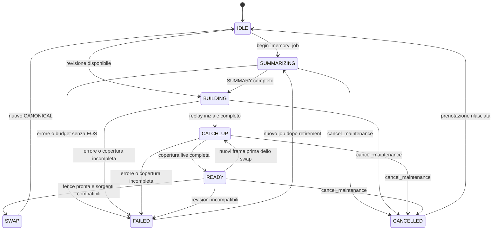

# Gemma 4 Full-Duplex Omni Architecture

Questo documento descrive l'architettura attiva del sistema di dialogo vocale continuo full-duplex.
La descrizione distingue i contratti visibili nel codice dalle osservazioni runtime; le parti non provate su GPU sono indicate esplicitamente.

## 1. Visione d'Insieme del Sistema

La pipeline realizza un'interazione vocale continua full-duplex speech-to-speech a 12.5 Hz (frame da 80 ms a 16 kHz).
L'utente parla liberamente e il modello risponde in streaming continuo senza turn-taking rigido o VAD separato.

```
+--------------------------------------------------------------------------+
|                             Ingresso Audio                               |
|                    80 ms PCM @ 16 kHz (1.280 campioni)                   |
+------------------------------------+-------------------------------------+
                                     |
                                     v
+--------------------------------------------------------------------------+
|                           GemmaListener (C++/CUDA)                       |
|           Estrazione Mel 8 frame -> Soft Embeddings multimodali          |
|                  Shared micro-batch N = ready conversation count        |
+------------------------------------+-------------------------------------+
                                     |
                                     v
+--------------------------------------------------------------------------+
|                         Thinker (Gemma 4 E2B-it)                         |
|         Conformer USM 12 layer nativo + Decoder LLM Transformers 5.x     |
|          Emette stati latenti h_t in R^1536 e decisioni di controllo     |
+------------------------------------+-------------------------------------+
                                     |
                                     v
+--------------------------------------------------------------------------+
|                  FrameResidualQueryFiLMAdapter v2 (alpha=0.0513)         |
|             Modulazione FiLM continua: h_t -> Query Qwen in R^2048       |
|             Voce femminile canonica "gemma" (custom_voices/gemma)        |
+------------------------------------+-------------------------------------+
                                     |
                                     v
+--------------------------------------------------------------------------+
|                    Talker (Qwen3-TTS 12Hz + SubTalker)                   |
|           Esecuzione incrementale C++/CUDA (libqwen_talker_abi4.so)      |
|           Campionamento SubTalker HRCR/SACR (T=0.45, k=10, p=0.85)       |
+------------------------------------+-------------------------------------+
                                     |
                                     v
+--------------------------------------------------------------------------+
|                         Vocoder Code2Wav (24 kHz)                        |
|       Hook HAR pre-clamp a picco 0.95 (rescale_code2wav_preclamp)        |
|       Post-processing lineare: fade coseno + leveling -14 dBFS RMS       |
+------------------------------------+-------------------------------------+
                                     |
                                     v
+--------------------------------------------------------------------------+
|                              Uscita Audio                                |
|                        Streaming PCM a 24 kHz                            |
+--------------------------------------------------------------------------+
```

## 2. Componenti Core

### 2.1 Thinker: Gemma 4 E2B-it
- Modello base: Gemma 4 E2B-it con audio encoder nativo USM Conformer a 12 strati.
- Ingestione audio: embedding continui calcolati a 16 kHz.
- Formato prompt: chat template Transformers 5.x (`<bos><|turn>system...<|turn>user\n<|audio|><turn|>\n<|turn>model\n`).
- Prefill: chunk da 16 token con vincoli di tempo reale.
- Azioni full-duplex: `LISTEN`, `SPEAK`, `CONTINUE`, `YIELD`, `BACKCHANNEL`, `REPLAN`, `HARD_STOP`.
- La history conversazionale persistita contiene solo messaggi `user` e `assistant` (fino agli ultimi 16); istruzioni e messaggi `system` restano nel prompt della richiesta e non vengono copiati nella history della sessione.
- Il `ThinkerSampler` applica penalità, soglia min-token, trie BACKCHANNEL e legalità EOS prima di softmax/top-p; gli EOS rifiutati dal callback del protocollo sono mascherati prima del campionamento. Se il candidato viene rifiutato, la ricerca considera fino a 64 alternative finite ordinate per logit vincolato, prima del fallback; un fallback pool legale senza selettore nativo sceglie il massimo logit sorgente. I callback che propongono pool non avanzano il protocollo: le metriche pool sono registrate dopo l'esecuzione del token.

### 2.2 Talker: Qwen3-TTS 12Hz e SubTalker
- Modello acustico: Qwen3-TTS 12Hz 1.7B con vocoder Code2Wav a 24 kHz.
- Backend di inferenza: libreria nativa C++/CUDA `libqwen_talker_abi4.so`.
- Binding ABI: il runtime legge le dimensioni compilate da `native/qwen_talker/generated/qwen_native_topology.h`, le confronta con la configurazione Qwen caricata e valida shape, dtype e contiguità dei pesi vivi; i descrittori sono costruiti in memoria senza dipendere da un JSON SHA separato.
- Esecuzione incrementale: caching KV all-layer con riciclo di stato.
- SubTalker: campionamento stocastico controllato HRCR/SACR ($T=0.45, k=10, p=0.85$) sui codebook acustici 1..15.
- In streaming ordinario, i chunk PCM vengono già consegnati al callback: `talk()` non concatena né post-processa il WAV finale e restituisce un array vuoto. Le metriche conservano il numero di campioni emessi; le catture diagnostiche mantengono il percorso con WAV finale.
- Il prefill tokenizza separatamente il solo ruolo `<|im_start|>assistant\n` e il testo SAY diretto con `add_special_tokens=False`; gli ID raw non si ricavano più da posizioni fisse della stringa formattata. L'allineamento locale ottiene ID e offset dalla stessa chiamata sul testo diretto, richiede che il decode ricostruisca esattamente il testo e che gli span coprano ogni carattere. Offset sovrapposti sono ammessi per token byte-level; leading newline, spazi, punteggiatura ed emoji restano parte del testo e dei relativi span.

### 2.3 Condizionamento Prosodico Continuo: FrameResidualQueryFiLMAdapter v2
- Architettura: proiezione lineare con modulazione FiLM a scala appresa ($\alpha = 0.0513$).
- Spazio di transizione: mappa gli hidden state di risposta di Gemma ($h_t \in \mathbb{R}^{1536}$) direttamente sulle Query audio di Qwen ($q_t \in \mathbb{R}^{2048}$).
- Frequenza: modulazione frame-by-frame ogni 80 ms (12.5 Hz).
- Posizioni RoPE: zero virtual prefix token; la sequenza mantiene posizioni contigue. Questo non dichiara allineamento fonetico Gemma→Qwen o parola→audio.
- Voce canonica: identità vocale femminile fissa `"gemma"` (`custom_voices/gemma.safetensors`, x-vector puro).
- Checkpoint attivo: `checkpoints/frame_residual_adapter_emovo_query_film_v2_candidate.pt`.

#### SAY controller-guided live streaming

- Il prefill Qwen distingue testo completo e streaming. Con `include_text_eos=False`, riceve un solo ID testuale e lo somma al codec BOS nella stessa posizione, come il percorso streaming Qwen ufficiale. Non inserisce prima del BOS una posizione separata con quel testo e codec PAD. Gli altri ID testuali arrivano come trailing text; il primo ID viene consumato una sola volta dopo il prefill riuscito. Il prefill completo mantiene invece testo ed EOS su codec PAD, seguiti da text PAD e codec BOS.
- Il consumer passa a `take_trailing_token` l'indice Q1 che usa anche per `apply_frame_residual`. Questo attiva la selezione dell'hidden della consumption riservata per quel forward. Senza indice, il selettore legacy per span può riusare un hidden precedente anche quando il token testuale corrente ha un hidden diverso.
- Quando il consumer V1 termina per cancellazione, cancella anche `LiveQwenSayStream`. La cancellazione sveglia il producer eventualmente fermo dentro `finish` sulla coda Qwen piena. Attendere il solo thread consumer lascia altrimenti un producer senza più lettore. `test_live_say_consumer_stop_releases_response_producer` verifica stop prima del primo token, durante il flush con coda piena e dopo EOS.
- `DUPLEX_AUDIO_RESPONSE_PROTOCOL` seleziona `controller_guided_say_v1` (default) oppure `heard_action_say_v2`; ogni altro valore è rifiutato. Se la variabile enum è assente, il compat toggle `DUPLEX_CONTROLLER_GUIDED_SAY_V1=1/0` seleziona rispettivamente v1/v2 e rifiuta valori diversi. Launcher e server usano la stessa risoluzione; health e metriche riportano l'enum effettivo. Gli errori del percorso SAY non ripiegano sul bundle JSON/heard.
- Il protocollo legacy `heard_action_say_v2` resta opt-in e valida il JSON completo prima di rendere disponibile il SAY. Con FrameResidual QueryFiLM attivo, l'adapter riceve soltanto gli hidden post-token conservati dal collector per il campo SAY; gli span del testo JSON-unescaped allineano tali stati agli offset Qwen. Gli stati `heard`, `action` e della struttura JSON restano esclusi. Gli hidden zero-width di un escape incompleto vengono associati al carattere prodotto quando l'escape si chiude. Questa route legacy continua ad attendere la validazione del collector; il default v1 streamma token e hidden mentre Thinker genera.
- Nel percorso direct-audio V2, `max_tokens` copre l'intero envelope JSON e i token di chiusura; il limite BACKCHANNEL di sei token resta applicato al solo campo SAY. Il budget totale non viene quindi ridotto sotto il minimo strutturale del protocollo.
- Dopo ogni forward Thinker, il callback consegna insieme il token testuale visibile e l'hidden state della stessa forward. Al primo pezzo testuale stabile parte un solo consumer Qwen in background. Il consumer usa la voce, il conditioning Talker e FiLM esistenti, il prefisso Q1 residuale vuoto `[1,0,2048]` e una sola sequenza KV/audio per risposta.
- Ogni `SpokenTokenPacket` possiede una copia dell'hidden Gemma e un evento CUDA registrato sullo stream che ha completato quella copia; il Talker attende l'evento sul proprio stream Q1 e registra lì la lifetime del tensor. Il handoff live non sincronizza la CPU e non attende lo stream Thinker intero. I lock serializzano separatamente il gruppo Gemma/Thinker-listener e il gruppo Talker/Qwen/codec; le attese FIFO restano fuori dagli scope di lock e stream.
- Nel commit V1 revisionato, `feed_piece` e il flush finale possono aggiornare l'allineamento e accodare gli ID Qwen senza pubblicarli. Il server registra prima la riga sorgente nel ledger e i packet del branch, poi rilascia lock generazione → branch → stream → ledger. Solo dopo attende capacità nella coda Qwen; prima di esporre ogni ID riacquisisce i lock nello stesso ordine e verifica generazione, risposta, revisione, packet e riga ledger. Il publish dentro questa verifica è non bloccante. Cancellazione o revisione concorrente eliminano il suffisso Qwen ancora differito; token, ID sorgente e ordine restano quelli prodotti dal tokenizer e la capacità della coda non cambia.
- Nel percorso `plain_native_audio_q1`, FiLM riceve l'hidden live dalla `QwenTextConsumption` riservata per l'indice Q1 corrente (`q1_index`): la consumption porta token Qwen, ID sorgente Gemma, hidden ed evento producer. Se un Q1 avanza senza un nuovo token testuale, il consumer riusa l'ultimo hidden consumato e marca il tail hold. `preserve_frame0` salta solo il primo Q1 globale (`generation_step == 0`). Le metriche conservano le somme quadratiche delta/base, RMS, rapporto e traccia degli hidden realmente consumati; il coseno first-last confronta solo oggetti hidden distinti e non conta il tail hold. In V1 i campi Gemma opzionali restano nulli quando il retokenizer non conserva l'identità di un singolo source token. Il riepilogo CPU avviene a fine turno, non per frame.
- `LiveQwenSayStream` usa gli offset del tokenizer Qwen caricato per associare ogni span Qwen ai pezzi Gemma sorgente. Il `SpanAlignedSpeechCursor` conserva inoltre una stima legacy di span PCM: testo vuoto dopo `strip` vale 1; altrimenti si contano i caratteri alfanumerici, oppure, per superfici di sola punteggiatura, 2 unità per `.?!;:` e 1 per gli altri segni; si applica `round(alpha / 1.15)` con minimo 1 e massimo 6 frame da 80 ms. Questa stima supporta la contabilità legacy per span e ACK PCM; non seleziona l'hidden FiLM nel percorso Q1 corrente e non costituisce allineamento fonetico né misura della durata acustica. Gli ACK PCM avanzano separatamente al rilascio server dei frame e verificano l'ordine span/source e il commit KV.
- Nell'ACK per-frame di controller-guided v1, `consume_qwen_token` resta il confine d'ingestione/pacing. `ack_emitted_audio_frame` avanza solo dopo che il chunk PCM è stato rilasciato dal server e accetta generazione, segmento e frame contigui. Gli ACK dei frame dipendenti da un packet Gemma anticipato (`kv_committed=False`) restano in attesa fino al commit della stessa coppia cursore/identità; una cancellazione li scarta. `on_packet_emitted(cursor, cumulative_vocalized_text)` avanza la frontiera canonica solo in ordine sorgente, quando il packet è committed e tutti gli span Qwen che dipendono dal suo testo hanno emesso il primo frame PCM. Questo consente rollback YIELD parziale al prefisso effettivamente emesso. Il confine temporale di questo ACK è il rilascio server del chunk WebSocket; non dimostra che il client abbia riprodotto i campioni. `client_consumed_pcm` misura separatamente il trasferimento logico nel buffer del dispositivo, non l'uscita acustica.
- Il callback legacy `on_audio_chunk` deriva l'horizon dall'ultimo frame nel chunk PCM appena prodotto: `next_generated_frame_id + chunk_samples / AUDIO_FRAME_SAMPLES - 1`. Il callback stateful mantiene invece l'horizon V9 effettivo passato dal decoder. Questa distinzione evita di trattenere il primo chunk legacy fino al callback successivo; il delay configurato nel buffer resta applicato a entrambi i percorsi. Il rilascio PCM e l'ACK server non certificano la riproduzione acustica sul client.
- La verifica CPU sul percorso `LiveQwenSayStream` usa 13 token per 41 frame stimati; il Talker mock esegue 42 query Q1, applica un residuo RMS positivo e registra un solo frame in tail hold. Il fixture storico «Le ore sono le 14:30.» non contiene superfici token o offset: la ricostruzione euristica da 11 token totalizza 19 frame e lascia 21/40 frame in tail hold (52,5%), quindi fallisce la soglia <25%; non è una riproduzione esatta del report. Nessuna delle due prove CPU certifica qualità fonetica, latenza end-to-end o playback client.
- Il Thinker della route unified nativa invia token a `ListenerMicroBatchWorker.append_text_tokens`, che accoda il comando all'owner thread; l'owner esegue `UnifiedTokenAdapter.prepare` e `native.step_async` senza acquisire il lock Python condiviso Gemma/Thinker per token. Le metriche riportano quindi wait `0`, acquire count `0` e provenance `native_no_python_decode_lock`; l'attesa della queue/Future è distinta e non viene chiamata attesa del model lock. Questa topologia runtime nativa differisce da quella delle misure storiche basate sul Thinker Python, quindi i tempi tra i due report non dimostrano uno speedup causale.
- Probe V1 del 2026-10-21 sul WAV di 3,048 s «Ciao, mi dici che ore sono?» (una risposta, testo prodotto «Ciao.»): FiLM `applied` su `same_forward_live_gemma_hidden`, RMS `0.0022021`, RMS/base `0.0311953`, coseno hidden first-last `0.384054`, 32 hidden Q1 tracciati e 31 chiamate adapter; lock decode Python wait `0 ms`, acquire count `0` con provenance `native_no_python_decode_lock`. Il dato descrive questo singolo turno e non misura qualità dialogica; il confronto con il report storico Python usa runtime diversi. Report e trace completi: `artifacts/conversation_quality_20261014/chat_baseline_natural_20261015/say_only_streaming_20261016/taskD_film_and_stream_fix/report.json`.
- Il producer usa il backend e il pre-tokenizer del fast tokenizer Qwen effettivamente caricato (`pre_tokenize_str`), senza holdback fisso o `data/tokenizer.json`. NFC normalizza il testo cumulativo e conserva una mappa carattere-span verso i pezzi Gemma, inclusi i caratteri accentati composti tra pezzi. Pubblica solo token Qwen con span prima dell'ultimo segmento pre-tokenizer ancora mutabile; i prefissi di AddedToken caricati restano bufferizzati finché non sono disambiguati. Ogni feed verifica che ID, offset e hidden già pubblicati non cambino; EOS confronta esattamente ID, offset e hidden con la tokenizzazione completa.
- Il token Qwen 0 entra una volta nel prefill senza EOS testuale. Il cursore degli hidden FiLM per i frame parte separatamente da zero; il cursore del testo trailing Qwen parte dal token 1. L'EOS testuale nativo viene aggiunto una sola volta dopo il flush; padding è ammesso solo dopo la chiusura e l'esaurimento della coda. L'EOS codec resta mascherato fino a quel momento. Una coda bounded e cancellabile sveglia producer e consumer in chiusura, errore o cancellazione. Il budget acustico cresce con il testo disponibile ma non supera `ARIA_MAX_FRAMES`.
- Feed e finish atomizzano gli errori e svegliano producer/consumer. I limiti coprono caratteri e pezzi sorgente, ID Qwen e righe hidden osservati, lavoro cumulativo di retokenizzazione e capacità della coda; attese iniziali e trailing rispettano cancellazione e stop. Nessuna attesa di testo mantiene il lock Thinker, Talker o GPU priority.
- Il consumer conserva il contesto Talker della risposta e usa il callback PCM esistente. Il testo utente non viene inferito dal SAY dell'assistente: un transcript entra nella history solo tramite il percorso di trascrizione confermato. Il commit assistant di archive/history usa la proiezione del ledger della risposta, con ordinamento che impedisce a una risposta vecchia di sovrascrivere una più recente.

#### Continuazione SAY rivedibile durante l'ascolto
- Il listener per-sessione continua a consumare i Q2 in ordine anche durante il parlato dell'assistente. Una revisione fork-a la cache al watermark listener scelto, applica la transizione del template e riproduce gli ID originali del prefisso assistant congelato; il suo stato di ascolto resta separato dalla continuazione testuale.
- Il branch SPEAK V1 revisionabile espone il proprio `response_decode_handle` come cache live; non richiede l'apertura della shared assistant audio queue, che appartiene al percorso non revisionabile.
- La sessione nativa di continuazione conserva KV, logits, sampler, RNG, decoder incrementale e cursori tra checkpoint. Ogni avanzamento candidato si ferma dopo al massimo 8 token committati; pubblica soltanto testo Unicode stabile e ID Qwen stabili. Se il limite scade mentre il decoder trattiene una sequenza UTF-8 o il segmento finale del pre-tokenizer, il checkpoint può contenere righe private senza span Qwen e non forza un flush.
- La promozione verifica sotto CAS l'identità di sessione/generazione, revisione attiva, epoch/cache, watermark listener, prefisso sorgente congelato e frontiere Qwen/ledger. Promuove il branch nativo già eseguito e sostituisce solo il suffisso non assorbito; il consumer Qwen/Talker e lo stream PCM esistenti continuano senza riavvio. Un candidato obsoleto viene scartato e la richiesta più recente resta accorpata in coda.
- Il CAS del worker stacca immediatamente il vecchio handle ACTIVE; la sua riga nativa viene rilasciata fuori dal commit applicativo e soltanto dopo l'evento CUDA pendente. Il risultato finale viene aggiornato dalla sessione promossa prima del drain; in rollback si riproducono una sola volta la transizione originale e gli ID sorgente assistant effettivamente confermati.

#### ACK PCM client e ledger della risposta
- `ResponseEventLedger` mantiene frontiere distinte per token sorgente generati, testo TTS consumato, campioni PCM sintetizzati, campioni PCM inviati e campioni PCM consumati dal client; registra separatamente anche il testo TTS riservato. Il cursore KV fisico resta provenance per revisione/epoch, non l'identità o l'ordine logico dei token.
- Nel fallback direct-audio V2 non unified, il ledger conserva gli ID originali dei token SAY e i relativi pezzi testuali dal campo validato, assegnando una sequenza logica distinta a ogni occorrenza anche quando ID e testo si ripetono. Non assegna un cursore KV fisico; segna il testo come consumato solo dopo il ritorno riuscito del prefill Qwen che include l'intero input. La stessa lista sorgente viene chiusa con l'unità PCM solo con EOS codec verificato; la proiezione completa richiede comunque il watermark client valido per tutti i campioni dell'unità.
- Nel fallback V1 non unified SPEAK, il flusso live conserva gli ID e i pezzi originali con sequenza logica, senza inventare un cursore fisico; BACKCHANNEL registra gli stessi dati dopo la validazione della frase e prima del prefill. Il ledger avanza al confine post-forward Qwen; la chiusura della sorgente completa richiede anche EOS testuale consumato e corrispondenza del testo NFC completo. I watermark PCM parziali non stabiliscono allineamento parola-audio. L'archivio assistant può essere completo mentre `session.history` resta in attesa del transcript utente indipendente.
- Un packet sorgente canonizzato senza span Qwen/PCM non avanza da solo il prefisso confermato: il suo testo resta in attesa e viene incluso nel prefisso cumulativo soltanto quando un successivo packet sorgente con span audio riceve l'ACK PCM. Il testo senza span che resta in coda alla risposta non viene confermato da ACK precedenti.
- `client_consumed_pcm` v2 accetta watermark progressivi prima di `response.audio.segment_done`. `start_sample` identifica l'inizio originale del segmento e `end_sample` è il watermark cumulativo esclusivo; `sequence` cresce per connessione. Il server copia e valida l'intervallo esatto contro PCM già inviato, identità response/generation/segment e sample rate a 24 kHz. La branch response conserva una tupla canonica per ogni sequence finché resta registrata: un duplicato identico è idempotente e lo stesso sequence con contenuto cambiato viene rifiutato. La cache globale della connessione è bounded e non sostituisce la branch; una branch ritirata rende l'ACK sconosciuto.
- Dopo una cancellazione, un ACK v2 `final` tardivo può completare soltanto un branch noto della risposta cancellata, con la sua generation e finestra massima di due secondi. La selezione del branch non dipende dalla generation attualmente attiva. Il protocollo v1 resta limitato al consumo dell'intero segmento chiuso e non rappresenta avanzamento PCM progressivo.
- Un watermark PCM parziale conferma campioni e intervallo esatti, ma non stabilisce confini di parola o l'allineamento testo-audio. Una riga source è confermata solo se si trova entro la frontiera TTS-consumed e appartiene a un'unità TTS chiusa e interamente consumata dal client. Il testo è `completed` solo se tutte le righe source soddisfano entrambe le prove, la risposta è terminata senza cancellazione o limite di lunghezza e ogni campione PCM inviato è stato consumato; `all_pcm_consumed` resta una frontiera separata e non completa da sola il testo previsto. Il rollback KV e il commit history usano la proiezione logica response/generation/revision del ledger, mantenendo separati cursore fisico e consumo client; righe source logiche senza cursore fisico mantengono `None` anche nei campi cursore della branch dopo ACK e finalizzazione.
- Nel SAY V1 unified, la frontiera di consumo Qwen è l'unica sorgente dei delta testuali; il Thinker non ripubblica il testo completo al termine del decode. Il fallback finale `response.output_text.delta` viene inviato solo se la risposta non ha pubblicato delta testuali incrementali. La decisione usa il contatore response-local dei delta consegnati, perché lo stato del segmento attivo può cambiare mentre la risposta continua.

#### Telemetria Thinker realtime e ACK
- `response.thinker_metrics` invia una proiezione leggera, con JSON UTF-8 compatto sotto gli 8 KiB: conserva timestamp e scalari di primo livello, i campi scalari/timestamp del profilo nativo e i riepiloghi; sostituisce `append_steps` e `sampling_steps` con i rispettivi conteggi ed esclude le strutture per-token non limitate. Le liste complete e il profilo interno restano disponibili a `update_runtime_metrics` e ai report offline.
- Per `input_audio_buffer.consumed`, `server_ack_queue_ms` conserva il significato esistente: tempo monotono dall'enqueue dell'evento dello scheduler al dispatch del sender, prima dell'acquisizione del lock WebSocket. `server_ack_lock_wait_ms` misura separatamente il tempo monotono da subito prima di richiedere `ws_send_lock` fino alla sua acquisizione; è un campo scalare additivo e lascia invariato il campo legacy.

#### Archivio delle risposte terminali
`playback_ack_branches` resta il registro operativo per ACK PCM, cursori, rollback e watermark di cancellazione; mantiene invariata la finestra di grazia degli ACK. `TerminalResponseArchive`, conservato in `app.state.terminal_response_archive`, riceve invece uno snapshot leggero quando termina ciascun task finalizer e resta consultabile dopo la chiusura del WebSocket. È un FIFO condiviso dal processo con capacità massima di 64 risposte; l'inserimento ripetuto della stessa coppia sessione/risposta aggiorna il record senza duplicarlo. I record contengono soltanto scalari, intervalli di segmento scalari e i contatori dell'allocator CUDA letti alla finalizzazione: non trattengono PCM, tensori, task, code o ledger operativi. `/debug/runtime-telemetry` unisce i record archiviati ai branch attivi e sintetizza le sessioni già chiuse, applicando i filtri `session_id` e `response_id`.

#### Unified v2: pacing SAY Gemma→Qwen
- Nel percorso `DUPLEX_UNIFIED_KV=1` il parser v2 pubblica SAY stabile mentre genera e lascia al controllo JSON finale la decisione di chiudere il flusso. Un turno possiede una sola `TurnLocalSpeechFIFO` di capacità 4; il callback Thinker avanza al massimo 2 token Gemma per finestra monotona da 80 ms e aspetta il tick successivo quando esaurisce il budget. Il pacer inizia solo dopo il primo testo pronunciabile estratto dal SAY e quando la FIFO ha almeno 2 packet pendenti; prima del SAY o con FIFO starved ritorna senza attesa e azzera quota/origine del tick, così il primo token pronunciabile non eredita ritardi pre-vocali. Non recupera finestre saltate con burst.
- Il frame budget del Talker cresce con il testo SAY stabile. L'import della KV nel decoder Q1 riserva il cap live già configurato (512 frame di default) solo per stream incrementali; `T_gen` resta il limite dinamico text-derived del loop. Questo evita che la cache importata sul primo prefisso tronchi la risposta prima che il budget possa crescere.
- Ogni packet conserva il token Gemma, il pezzo SAY, l'hidden post-forward dello stesso token (`[1,1536]`) e la sua posizione KV. La codifica Qwen è incrementale per pezzo completo e deve ricostruire esattamente il testo; tutti gli ID Qwen associati al pezzo riusano quel preciso hidden. La testa FIFO resta occupata fino al forward Q1 riuscito dell'ultimo ID associato. La posizione `last_vocalized_kv_position` è quindi un ACK di consumo da parte della sintesi Qwen, non un ACK di playback del client.
- Se il flusso v2 viene rifiutato prima del primo ACK Qwen, lo snapshot è `(None, "")`: non esiste un cursore di parlato, il finalizer non inventa la posizione zero e riporta il KV al confine del turno utente lasciandolo aperto. Testo senza cursore ACKato è un errore esplicito.
- `preserve_frame0` si applica soltanto al primo Q1 step assoluto del turno. Il percorso live passa poi direttamente all'adapter l'hidden `[1,1,1536]` del packet selezionato, inclusa la ripetizione controllata dell'ultimo packet in tail hold; il contatore `frame_residual_calls` esclude il primo step preservato. La metrica runtime riporta anche il coseno tra primo e ultimo hidden distinti.
- L'allineamento è tra packet Gemma e ID Qwen, non tra token, parole, fonemi o millisecondi. I tokenizer possono segmentare diversamente; i pezzi visibili che producono zero ID Qwen sono rifiutati esplicitamente, e i token parziali UTF-8 restano soggetti alla decodifica stabile del Thinker. Un packet coperto da più ID Qwen usa il medesimo hidden su ciascun forward; i frame codec/padding non vengono contati come nuovi packet vocalizzati.
- L'output PCM verso il relay resta bounded a 4 pacchetti. Il buffer di playout rilascia i frame in base all'horizon passato dal decoder e al delay configurato; il suo limite di 256 frame è un guardrail contro anomalie, non una misura del lead effettivo o del playback remoto. Non è disponibile un ACK che certifichi che il client abbia riprodotto l'audio.
- Gli eventi runtime espongono la peak/remaining FIFO, il budget pacer, il cap di import Q1, la capienza della coda PCM e fino a 256 righe di provenance Q1 con ID, posizioni KV, hidden norm/cosine e flag `tail_hold`; non serializzano i tensori. Le righe `tail_hold` descrivono query acustiche che riusano l'ultimo hidden, non nuovi token Gemma vocalizzati.
- Barge-in congela la proiezione logica della risposta prima di svuotare la FIFO. Ogni `begin_response` conserva il cursore KV al confine della risposta; in assenza di testo confermato, il rollback usa quel cursore, anche se vale zero. Le revisioni tengono distinti i source token immutabili, la provenance dei cursori KV e il testo confermato dal ledger. Il finalizer ricostruisce solo il prefisso source confermato e drena i frame utente accodati; il PCM parziale non viene convertito in parole o testo stimati. ACK Qwen è consumo della sintesi, mentre `client_consumed_pcm` è trasferimento logico nel buffer del dispositivo e non prova l'uscita acustica.

### 2.4 Vocoder e Trasparenza Acustica (Anti-Clipping)
- Causa radice della distorsione passata: saturazione flat-top nei layer convoluzionali HAR del decoder Code2Wav.
- Correzione alla radice: hook `rescale_code2wav_preclamp` a picco massimo 0.95 in `duplex_kernel/models/talker.py`.
- Pulizia post-process: rimosso completamente ogni filtro analogico attenuatore high-shelf. L'intera banda acustica a 24 kHz e l'aria delle alte frequenze (8-12 kHz) sono preservate integre.
- Leveling: soft-knee lineare trasparente con target a -14.0 dBFS RMS e ceiling a -1.5 dBFS.

### 2.5 Listener e Micro-Batching
- Compatibilità del contesto Control6: il checkpoint `native_control6_gemma_native_rows_rank16_control6_temporal100_candidate_h_3000_20261021.pt` usa feature estratte con il prefisso `heard_action_say_v2`. I 190 token senza istruzioni aggiuntive coincidono con quelli ricostruiti dal builder V2; il manifest delle feature è in `checkpoints/gemma4_duplex_control6_candidate_h_natural100_pcm_temporal_native1540_20261021/features_native1540_merged_temporal2_20261021/feature_manifest.json`. Il prefisso V1 chiede invece solo il parlato e vieta di riclassificare l'azione. Con una cache condivisa questo cambia anche il contesto della head Control6, non soltanto il formato della risposta Thinker. Il passaggio tra protocolli richiede quindi una verifica delle azioni sul runtime reale con i pesi installati.
- I tick con PCM esattamente nullo durante il playback seguono una soppressione specifica della head; un frame con rumore non nullo non segue quel ramo. Le prove con soli zeri non rappresentano il microfono browser. La reference assistant è indicizzata al rilascio WebSocket, non alla riproduzione acustica; il server può inviare fino a circa due secondi in anticipo sul consumo realtime. Questi due tempi devono restare distinti quando si interpretano interruzioni e possibile eco.
- Diagnostica shadow (snapshot health, senza log per tick): `diagnostics.current_job` espone SID, generazione, epoch, revisione semantica, frame base della richiesta, fase, timestamp monotoni di richiesta/coda/inizio e attesa del fair lock; riporta build teacher del solo prefisso testuale, fence del prefisso e import nativo (`teacher_prefix_replay_wall_ms` resta null perché la history viene riprodotta da M4). `diagnostics.q4` espone conteggi inviati/completati, ultimi frame, profondità corrente/massima e statistiche aggregate somma/count/massimo per attesa Q4 live, fence, validazione health e enqueue della copia candidato. Il contatore CAS/cursore e i rifiuti preflight/copia promozione conservano l’ultimo motivo conciso. I tempi avvolgono solo attese e chiamate già previste e non aggiungono sincronizzazioni GPU; non costituiscono una misura di performance o una certificazione.
- Cadenza: frame PCM da 80 ms a 16 kHz (1.280 campioni).
- Percorso di produzione: `scripts/start_speech_service_3090.sh` avvia `gemma4-listener-control6-microbatch-20261014` dall'immagine locale `gemma4-listener-control6-baseline-snapshot-20261014:latest`. Mantiene la policy nativa Control6 candidate600 con BOA-v2, Qwen talker e conditioning esistenti. Il launcher imposta `DUPLEX_LISTENER_MICROBATCH=1`, `DUPLEX_LISTENER_MICROBATCH_SEMANTIC_SHADOW=1` e `DUPLEX_LISTENER_MICROBATCH_GEMM_GRAPHS=0`; `DUPLEX_LISTENER_MICROBATCH=0` avvia il percorso standard per-sessione come rollback. Il health startup confronta il toggle richiesto e, quando attivo, verifica shadow `1` e graph GEMM `0`. `runtime_ready` è vero solo dopo avvio completo del worker e del dispatcher, anche quando non ci sono sessioni.
- Dispatch realtime: `response.create` manuale con solo testo usa la normale history di sessione e `apply_chat_template`, anche se il candidato audio è abilitato globalmente. Con `auto_response=false`, commit/response manuali con PCM esplicito sul percorso audio diretto sono SPEAK e mantengono lo snapshot completo. Nel protocollo V1 con controller autorevole, `input_audio_buffer.commit` viene accettato senza creare una risposta action-less e conserva il PCM pending perché la policy opera sul flusso live; gli ACK per-frame `input_audio_buffer.consumed` restano il riscontro d'ingestione. La guardia `RESPONSE_ACTIVE` resta valida per i commit manuali e per `response.create`. Una risposta causata da audio resta sul percorso audio diretto; se il suo snapshot PCM causale manca, la richiesta fallisce esplicitamente senza fallback testuale.
- Cache Thinker unificata: `controller_guided_say_v1` è il default e funziona con `DUPLEX_UNIFIED_KV=1`; `heard_action_say_v2` resta una scelta esplicita. Il prefix token-only è ricavato dal template effettivo e termina al vero BOA, quindi viene importato una sola volta nella cache nativa per sessione. V1 include nel prefisso stabile lingua, history e istruzioni audio con richiesta di solo testo pronunciabile; non aggiunge JSON o una nuova istruzione d'azione dopo l'import. Il controller sceglie SPEAK/BACKCHANNEL fuori dal prompt dinamico. Il suffix audio usa il decoder nativo sullo stesso owner/cache senza nuovo prefill audio o audio tower. Durante SPEAK, i tick listener Q0 pubblicano policy hidden e accodano i soft-token Q2 per il prossimo user turn; i token assistente sono conservati soltanto se la risposta SAY termina e l'aggiornamento history viene committato. Q0 e la coda del prossimo turno restano legati alla shared assistant audio queue. BACKCHANNEL usa una fork KV privata; il cleanup libera soltanto la fork, mentre il finalizer SPEAK chiude il ramo con EOT e il prossimo header user/BOA prima di drenare Q2 in FIFO. Cancel, risposta saltata o errore ripristinano il cursore pre-risposta e drena i Q2 nell'user turn già aperto. La brevità del BACKCHANNEL non può dipendere da una nuova istruzione system aggiunta dopo l'importazione.
- L'import unificato assegna esplicitamente al prefix la revisione semantic/history rappresentata: `0` alla registrazione e la nuova revisione quando si aggiornano le istruzioni prima dell'audio. Ogni branch di risposta riceve così watermark completi e coerenti con il contesto realmente importato.
- Control6 mantiene LISTEN durante il run vocale dell'utente; SPEAK diventa legale dopo l'endpoint rilevato dal tracker. Gli altri tick listener da 80 ms e le azioni valide per lo stato restano attivi.
- Endpoint Control6: il tracker stabilisce quando SPEAK diventa legale e associa onset ed endpoint alla stessa voce utente. Non sostituisce una decisione LISTEN o CONTINUE con SPEAK. Il rilascio endpoint viene registrato soltanto quando la head, la confidenza minima e l’isteresi hanno già scelto SPEAK. I test esercitano entrambe le API step e step_with_logits; un checkpoint che resta in HOLD dopo una domanda richiede verifica del contesto e delle decisioni reali, senza una risposta imposta dal tracker.
- Percorso condiviso e semantica: il dispatcher usa scadenze monotone comuni ogni 80 ms. A ogni scadenza raccoglie al massimo un frame reale pronto per conversazione e invia tutte le righe raccolte in una sola transazione al worker GPU condiviso. Il batch ha dimensione dinamica e arbitraria $N \ge 1$: non aspetta per riempirlo, non spezza il tick in chiamate seriali e non crea righe di silenzio. Il default opt-in dei moduli e dei test di basso livello può restare disattivato; il launcher di produzione configura esplicitamente i tre valori sopra. La shadow semantica usa l'owner priority-0 e slot capacity 1; con Control6 semantico e micro-batch è obbligatoria, senza fallback inline o refresh sincrono.
- Diagnostica stallo dispatcher: `DUPLEX_LISTENER_STACK_WATCHDOG_MS` attiva un dump one-shot degli stack Python di tutti i thread quando un intero tick supera la soglia, includendo attesa deadline, batch/Future e fanout dei callback; il valore predefinito `0` lo lascia disattivato. Il dump registra fase, durata tick/fase, tick, sessione e frame; il dispatcher prosegue il lavoro corrente senza cancellarlo o cambiare il percorso GPU.
- Sorgenti e libreria: `scripts/start_speech_service_3090.sh` configura il DSO `artifacts/runtime/libgemma4_listener_microbatch_fullrepeat_20261014.so` per entrambi i loader standard e micro-batch, ma avvia il codice Python canonico da `/workspace/duplex_kernel/launch.py` con working directory `/workspace`. Il launcher mette `/workspace` per primo nel `PYTHONPATH` e aggiunge solo `artifacts/runtime/listener_microbatch_source/runtimepackages_original` per i pacchetti Qwen originali; non copia i pacchetti né seleziona il mirror Python `listener_microbatch_source/duplex_kernel`. Il launcher registra i percorsi dei moduli importati e le versioni di Python, Torch, Transformers e Tokenizers, così l'origine runtime si può verificare dai log.
- Graph e capacità: i graph GEMM restano disattivati in produzione. Prima di ammettere sessioni, il worker prealloca la capacity primaria iniziale 4, come suggerimento espandibile, e la shadow capacity 1. Non viene introdotto un limite massimo di batch o sessioni: il worker cresce gli slot nativi al confine del tick prima di importare o processare le righe, preservando lo stato KV già attivo. Il primo valore di `max_batch_size` è un suggerimento di allocazione; la crescita che non riesce per limiti reali di risorse restituisce un errore di ammissione esplicito.
- Scratch full-attention nativa: il contesto alloca tre buffer iniziali a `min(2048, max_seq_len)`; la regola viene da `kInitialCapacity` e dal raddoppio clampato in `native/gemma4_listener_microbatch/full_repeat_capacity.h`. Prima del forward nativo, quando `max(row.cache_position + stream_q_len)` supera l’high-water mark del contesto, il wrapper chiama una sola volta `torch.cuda.empty_cache()` e registra allocated/reserved/free prima e dopo, byte reserved rilasciati e durata. PyTorch libera solo blocchi cached inattivi: la chiamata non libera tensori attivi né garantisce memoria sufficiente. L’high-water mark avanza solo dopo un forward riuscito e si azzera con la chiusura del contesto; input oltre `max_seq_len` non innescano reclaim. Un forward nativo fallito continua a quarantinare il contesto senza retry.
- Frontend: `listener_microbatch_frontend.py` prepara feature `[N, 1024, 128]`, intercalando per riga la history Mel utente e quella dell’audio dell’assistente. La reference dell’assistente viene congelata con `AssistantReferenceBuffer.visible_for(frame_id)` alla raccolta del frame. Ogni blocco da 512 righe mantiene history cronologica, padding zero a destra e mask audio tutta vera su 1024 righe, come nel percorso standard. Il frontend copia il batch una volta; il tower GPU conserva la geometria M=1 ed è chiamato una volta per riga.
- Isolamento: ogni conversazione mantiene code PCM, history Mel, cursori, epoch e slot KV nativo privati. I pesi sono condivisi; il tower audio mantiene la geometria per-riga N=1, mentre LM nativo e scoring grezzo Control6 processano tutte le righe pronte nel batch. Il risultato batch viene ricondotto a `GemmaListenerState.commit_microbatch_output`, poi passano i callback esistenti per policy, azione e speaker.
- Health Control6: dopo l'evento CUDA il worker legge una volta il finite-guard nativo per il batch e associa a ogni riga uno snapshot immutabile con generazione, conversazione, epoch e cursore pre-step. Il guard nativo è aggregato: se segnala un valore non finito, l'intero batch viene quarantinato prima del commit e nessuna riga viene consegnata alla policy. Il server confronta lo snapshot con la riga committata (la versione nel descrittore è quella precedente al frame).
- Prefisso semantico Control6: il builder usa gli ID effettivi del chat template, termina sul vero token BOA e conserva la lunghezza reale `1..512` (la capacità è un limite di importazione, mai padding). La capacità runtime della maschera semantica è separata dal prime canonico `M=291`: il DSO alloca 512 elementi per le maschere importate, inclusi tutti gli slot microbatch, mentre PLE, scratch e forma del prime restano 291. Import, clone e rebase copiano/usano solo la lunghezza effettiva e il cursore resta `prefix_len + 2*n`; i checkpoint BOA-v2 storici con metadati 291 restano validi. Per la KV destinata all’import nativo crea `DynamicCache()` senza config: in Transformers 5.5 mantiene fisicamente tutti i K/V, necessari all’ABI nativa. Il config Gemma4 originale e la cache sliding del percorso standard restano invariati; `create_masks_for_generate` continua a costruire la maschera `sliding_attention` con finestra 512. La route standard e il builder full-cache sequenziale restano il riferimento invariato.
- Compattazione listener di produzione: la factory server passa sempre un builder per-sessione al worker condiviso. La soglia automatica predefinita è 8.192 token, il target 4.096 e il limite nativo 16.384; il worker conserva l'intero ring degli ultimi 200 frame Q2 (16 secondi). L'adattatore prepara fuori dal worker prefissi da template/tokenizer reale, massimi 512 ID; quando serve ridurre la history elimina solo turni user/assistant completi più vecchi, senza tagliare il testo. Prima del ring ogni frame deve avere una classe VAD CPU esplicita derivata dal PCM grezzo del frame: i frame nonvoice sono coperti dalla classificazione stessa, mentre ogni frame voice richiede una sorgente con copertura completa e contenuto effettivamente rappresentato nel prefisso ricostruito. La provenienza non richiede l'esecuzione ASR. Il cutoff è esattamente il frame precedente al ring; gli span devono terminare prima del ring e non sono mai ritagliati a metà. VAD, archivi e replay vengono legati al `timeline_id` logico stabile, che sopravvive alle promotion di epoch fisici e cambia soltanto quando viene reinizializzato il clock audio; ogni archive conserva anche il proprio epoch d'origine. Messaggi testuali senza provenance restano contesto ma non provano copertura audio; sorgenti di un'altra timeline non autorizzano il cutoff corrente. Un frame mancante, una classificazione non disponibile, voce senza contenuto ricostruibile o un ring Q2 incompleto producono un errore tipizzato `capacity_blocked`; il worker conserva i frame accettati e può riprovare quando riceve nuove classificazioni o una history aggiornata. Le callback di archive, response-ledger e variazione del contesto preparano snapshot/revisioni per-sessione e invocano `request_listener_compaction` in background anche sotto soglia, senza bloccare il listener. La ricostruzione usa uno shadow su stream priority 0 anche quando semantic-shadow legacy è disattivato, processa replay a un frame per quantum e promuove solo dopo catch-up e CAS dell'epoch/cursori. Le richieste in attesa si riprovano dopo 16 token KV, una nuova revisione history o pressione di capacità.
- Identità della cache listener: `state_epoch_id` identifica la generazione/cursore logico del listener e `timeline_id` la timeline audio; nessuno dei due cambia per una compattazione. Il worker possiede invece un `cache_epoch_id` monotono per sessione, iniziale a zero, che avanza solo quando la copia del prefisso compattato ha superato la fence CUDA. Gli snapshot espongono l'epoch, la revisione tecnica del prefisso e la revisione di history effettivamente applicata; i watermark espongono l'epoch e la revisione di history. I fork ACTIVE mantengono l'epoch sorgente immutabile e restano utilizzabili dopo compattazioni; i fork CANDIDATE fanno CAS su `cache_epoch_id` e `applied_history_revision`. La pubblicazione dell'epoch del worker e del mirror sessione avviene nello stesso tratto protetto dai lock sessione-generazione e listener-state, dopo la fence e senza cambiare ABI del DSO nativo.
- Prefill semantico sopra `M=291`: il builder suddivide il prefisso reale in chunk causali di al massimo 291 token, usa posizioni assolute e una attention mask fino alla fine del chunk, poi ritaglia subito ogni cache alla lunghezza reale prima del chunk successivo. Un prefisso di 349 token produce quindi un cache cursor di 349 (e dopo `n` frame Q2 il cursor è `349 + 2*n`); non viene riempito semanticamente fino a 512 e non cambia il prime canonico.
- Estrazione Control6 Native1540: Stage2 salva un NPZ e il relativo JSON per conversazione sotto `conversation_partials/<split>/` dopo ogni replay completo. `--resume-existing` riusa solo partial con frame target, label, provenance, hidden Gemma, Q2 e W240 coerenti; una coppia mancante o incompatibile viene ricalcolata. Gli split finali vengono ricomposti nell'ordine originale del prepared input, mantenendo action mask e provenienza delle label.
- Refresh shadow semantico Control6: il request immutabile mantiene SID, generazione, epoch, revisione, ID BOAv2, capture watermark `current_frame_id`, Q4 congelati e frame ID originali. Sotto il fair model lock il worker teacher costruisce solo il prefisso testuale e sincronizza il suo stream per proteggere i workspace ShapeStable; rilascia il lock prima di importare la cache nel proprietario NativeBatch shadow priority-0 e prima di riprodurre la history. Ogni Q4 storico viene inviato in ordine al decoder nativo M4, senza snapshot K/V o copie candidate intermedi. Il cursore base è sottratto esattamente: `frame_id = target_frame_id - R`, `state_version = target_state_version - R`, `sequence_position = target_sequence_position - R`, `cache_position = prefix_len`. Si rifiutano underflow, tipi non validi, frame ID non contigui e ogni target cache cursor diverso da `prefix_len + 4R`; dopo tutti gli R step il frame, la versione, la sequenza e il cache cursor devono coincidere esattamente col target congelato prima di accettare Q4 live, esporre il candidato o avviare il CAS di promozione. Cancellazione, cambio identità, errore, reset e chiusura ritirano lo slot parziale; nessun fallback promuove una cache parziale.
- Evidenza numerica del replay shadow: il confronto GPU prototipale sul checkpoint e DSO esatti con `R=64` ha dato KV, hidden, raw6 e azione identici tra ABI3 standard e shadow M4; il percorso nativo ha impiegato `0.864 s` contro `3.691 s` per la costruzione teacher della cache con Q4. È una misura del prototipo sul caso confrontato, non una certificazione o una misura end-to-end del servizio. Il tentativo precedente di raggruppare 64 Q4 teacher in BF16 resta negativo: con BOAv2 `L=169` e 64 Q4 reali, il primo mismatch era in `layer0.keys` al primo Q4 (prefisso identico; K/V aggiunti con massimo errore `0.3125`), seguito da hidden con massimo errore `6.875` e score Control6 con massimo `2.09638`, pur selezionando `LISTEN`. La prova non superava cursore 512 (arrivava a 425); il corrispondente helper, opt-in e test di chunking sono stati rimossi. Il confronto tiny CPU float32, con errore massimo `3.94e-6`, non sostituisce la misura BF16 sul checkpoint.
  - Smoke del launcher ufficiale N=1 (14 ottobre 2026): 1.125/1.125 frame ACKati, nessun overflow o errore shadow, un replay/promozione completata e primary-applied revisione 2 con watermark 68 e 64 Q4 storici (frame 4–67). In 1.124 decisioni, compute batch p50/p95/max `37.854/43.509/99.448 ms`, deadline nominale→decisione `44.172/50.845/1,139.430 ms` (5 oltre 80 ms) e lateness deadline p50/p95/max `0.119/0.129/1,060.111 ms` (2 oltre 80 ms). Il test dimostra l’attivazione e la promozione shadow con un utente; la sessione non ha completato una seconda risposta dopo il follow-up e non misura N=2/N=3 o multiutente. I dettagli e l’ASR small timestamped sono in `artifacts/conversation_quality_20261014/microbatch_shadow_replay_n1_20261014/`.
- Q4 shadow live e promozione: le righe Q4 reali provengono dal medesimo `audio_tower_hidden` del frontend primario e la coda per sessione conserva il limite già esistente di 64 righe di history, senza introdurre un limite alle sessioni. Il worker scarta watermark non raggiungibili e attende uno snapshot successivo. Dopo il replay storico, il normale catch-up live continua dal cursore esatto. L’owner primario confronta generazione, epoch, frame, versione e sequenza e copia la sola KV valida nello slot attivo prima di congelare il manifest successivo; la copia è ordinata tra stream con eventi CUDA e lo slot sorgente resta pinned fino al fence, anche se arriva un reset o una nuova revisione. La promozione cambia solo cache/cursore; non avanza frame, epoch, versione o sequenza. Il priming canonico iniziale resta a 34 token.
- Ammissione iniziale Control6: dopo un `session.update` valido, se il listener è ancora al frame zero e l'ingress non ha ricevuto audio, il server prepara il prefisso semantico congelato su un thread e stream CUDA di preparazione distinti, sotto il fair lock del backend. La preparazione sincronizza quel solo stream prima di liberare il lock, così una successiva chiamata ShapeStable non può sovrascrivere i buffer prima che la cache sia pronta; i tick nativi delle altre conversazioni continuano sul worker owner. L'evento CUDA passa il cache al worker, che sul proprio stream fa solo CAS, eventuale rebase KV e import nello slot privato; non avanza frame, versione o sequenza e non crea una riga audio fittizia. Dopo l'import il server applica la revisione solo con un compare-and-swap atomico sotto lock di generazione e poi lock dello stato listener. Se revisione o cursore non corrispondono più, l'ammissione è `ineligible` e non marca il prefisso applicato; la posizione nativa resta quella realmente importata finché il refresh semantico del primo frame reale non la sostituisce. Un aggiornamento ripetuto prima del frame zero sostituisce lo slot mantenendo gli stessi cursori. Se prima dell'import cambia epoch/cursore/revisione o arriva audio, l'ammissione viene dichiarata `deferred_to_first_frame` e resta attivo il refresh già usato sul primo frame reale. `session.updated` riporta stato, durata complessiva di ammissione, fasi build/replay/import e campioni/frame audio già ricevuti o in coda; il prefill non viene attribuito al tick successivo. L'attesa avviene in modo asincrono, così il loop WebSocket e gli altri ingressi restano servibili.
- Commit e telemetria shadow: l'identità semantica è `(session_id, listener_generation_id, state_epoch_id, semantic_context_revision)`; frame e watermark descrivono lo snapshot, non l'identità. Il server notifica la shadow solo dopo l'import primario e il commit/CAS di `GemmaListenerState`; una revisione applicata R elimina stage e Q4 in coda con revisione `<= R` solo nella stessa generazione ed epoch. La notifica non esegue operazioni native: lo owner shadow ritira stage/candidate non reclamati sul proprio thread. Un promotion già reclamato resta in vita fino al completamento del fence di copia. Health espone i cursori essenziali dello stage active/candidate e dell'ultimo prefisso applicato (sessione, generazione, epoch, revisione, watermark della richiesta quando noto, frame effettivo di commit, versione, lunghezza prefisso e intervallo/count dei Q4 replay); il watermark ignoto resta null e non viene dedotto dal frame di commit. Non espone prompt o PCM.
  - Il `session_generation_id` del request identifica la generazione WebSocket e viene validato come intero; non viene confrontato con `listener_generation_id`, che appartiene al ciclo di vita dello stato listener ed è fornito separatamente allo stage. Cancellazione, cursore e promozione usano sempre la generazione listener dello stage.
- Provenienza del prefisso: l'audit ha ricostruito con il builder corrente e il tokenizer Transformers 5.5.0 originale tutti i 300 range di prefisso salvati per train e validation; i 300/300 ID coincidono esattamente, includono l'istruzione singola usata e terminano con il vero token BOA. Il report di estrazione collega inoltre gli ID salvati ai 19.758 frame e ai 300 update del candidato da 600 step. Questo conferma la provenienza token/template del prefisso; i confronti numerici delle attivazioni restano una verifica runtime separata.
- Control6 nel percorso condiviso: il worker applica l'adapter addestrato una volta alle righe hidden `[N,1536]` e associa a ogni snapshot di sei logit la provenienza immutabile della riga nativa. Il callback esistente della policy usa quei logit solo dopo avere validato sessione, frame, generazione listener, epoch, versione e cursori pre-step; continua poi a calcolare legal mask, confidenza e azione con la semantica per-sessione corrente. La generazione listener resta distinta dalla generazione WebSocket usata per cancellare risposte.
- Tracce: ogni tick conserva `scheduler_enqueue_ns`, `scheduler_deadline_ns`, `scheduler_observed_ns`, `scheduler_enqueue_to_deadline_ms`, `scheduler_deadline_lateness_ms` e `scheduler_observed_to_listener_start_ms`, oltre a `listener_batch_id`, dimensione, inizio/fine, attesa in coda e tempo totale. Il frontend espone `mel_prepare_ms` per riga e `frontend_copy_ms`/`frontend_copy_cuda_ms`; l'audio tower riporta l'attesa/tenuta di un eventuale lock esterno e, separatamente, quelle del workspace RLock (`audio_tower_workspace_lock_wait_ms`/`audio_tower_workspace_lock_hold_ms`), la somma degli intervalli CUDA di copia per riga (`audio_tower_row_copy_cuda_ms`), il tempo host di enqueue esclusa l'attesa del workspace lock (`audio_tower_graph_submit_ms`), la somma dei replay (`audio_tower_cuda_ms`), lo span CUDA dell'intero loop M1 (`audio_tower_batch_cuda_span_ms`) e la modalità effettiva (`audio_tower_execution_mode`). Il listener nativo separa il tempo host di submission (`native_submit_ms`) dal tempo CUDA dello step (`native_cuda_ms`); quest'ultimo si legge dopo il fence di health già esistente e senza sincronizzazioni aggiuntive. `listener_batch_cuda_completion_wait_ms` misura l'attesa host sulla coda finale dell'evento CUDA di completamento; `listener_batch_native_output_health_ms` misura separatamente la verifica del finite-guard e la sua sincronizzazione/copia, mentre `listener_batch_native_control6_raw_score_ms` misura lo scoring grezzo e il trasferimento dei sei logit. Non sono sinonimi e vanno conservati come fasi distinte. Gli eventi CUDA vengono letti dopo l'attesa di completamento già prevista dal worker, senza sincronizzazioni aggiuntive. I tempi di build, replay e import del prefisso sono associati solo alle righe che hanno eseguito quelle fasi nel batch corrente; i batch successivi mantengono revisione e lunghezza del prefisso ma non ripetono durate memorizzate. Un refresh espone evento, ID e revisione; il riepilogo somma le fasi per riga effettivamente eseguite e ignora le righe senza quel lavoro. Il client attende gli ACK finali prima di chiudere il WebSocket entro un timeout esplicito; se restano ACK pendenti, la sessione è incompleta e non è considerata sana. Le misure end-to-end del servizio corretto con Control6 nativo e prefisso semantico, per 1/2/4 conversazioni simultanee, restano da completare.
- Profilazione diagnostica del worker: `DUPLEX_LISTENER_TORCH_PROFILE_TRACE_PATH` e `DUPLEX_LISTENER_TORCH_PROFILE_FRAME_IDS` attivano temporaneamente un trace PyTorch CPU/CUDA soltanto per i batch selezionati, con intervalli nominati per frontend, decision view Q2, step nativo e attesa di completamento. L'impostazione è disattivata di default e non espone endpoint; il profiler può perturbare i tempi, quindi il trace serve ad attribuire lavoro CPU/GPU e sovrapposizione, non a certificare latenza o acceptance. Se il profiler/CUPTI non è disponibile, il worker registra l'errore e continua senza il trace.
- Contesa lock modello: con il percorso microbatch attivo, il primo ACK di ogni batch tenta una sola copia best-effort degli ultimi 64 eventi host del fair model lock (`listener_batch_host_lock_timeline`). La copia del callback è limitata al tail fisso, senza ordinare o copiare la history completa; il metodo per il sidecar finale conserva la snapshot completa fuori dal callback. La traccia è indipendente dal profiler CUDA e usa `time.monotonic_ns`; include ticket, priorità, thread, request/acquire/release, hold duration, pending counts e owner corrente. Il client conserva il risultato una volta per batch, mantenendo identificatore e contatori se la copia riesce; in contesa riceve uno stato esplicito di omissione senza eventi né timestamp di snapshot.
- Ammissione cooperativa Listener/Talker: il dispatcher conserva la domanda dalla coda ingress al batch selezionato/in volo fino alla completion CUDA, al risultato della `Future` e alla validazione degli output; rilascia poi priorità e ticket prima del fan-out host, che può pubblicare ACK. La transizione dequeue→in-flight e la lettura di domanda usano la stessa `Condition`; gli ingressi notificano i waiter. L'ammissione considera la domanda di tutto il servizio condiviso: qualsiasi frame accodato, selezionato o in volo fa cedere il prossimo quanto Talker, che procede negli intervalli senza lavoro Listener pendente. Il Talker esegue il controllo prima di acquisire il fair lock per ogni prefill, `codec_head`, SubTalker, Qwen e decode; anche il prefill audio-LM Thinker passa il controllo al lock e rivalida cancellazione/generazione dopo l'acquisizione. La cancellazione durante l'attesa rimuove il waiter senza avviare il forward. L'attesa dispatcher è su `Condition` con risveglio a completamento/ingresso e controllo cancellazione a intervalli di 50 ms; non usa sleep di polling stretto.
- Tempi Listener distinti: `shared_listener_batch_service_ms` misura dal callback batch al risultato con attesa della `Future` e validazione incluse; `shared_listener_worker_queue_wait_ms` misura submit worker→inizio batch; `shared_listener_worker_wall_ms` misura il wall-clock nel worker e include l'attesa esplicita del completamento CUDA. `shared_listener_cuda_completion_wait_ms` resta una sottofase host del wall worker, mentre `native_submit_ms` e `native_cuda_ms` sono viste host/device dello stesso step e non vanno sommate né sottratte come partizioni. `shared_listener_batch_compute_ms` resta solo come alias retrocompatibile del tempo service, non come misura del solo compute.
- Latenza listener/control: gli 80 ms sono la cadenza e il budget operativo del tick per consegnare la decisione selezionata. La `deadline` del dispatcher è il timestamp nominale dello slot (`anchor + (tick_index + 1) * period`), non una deadline di completamento. Il budget decorre da questo confine e include lateness, calcolo, contesa GPU e dei lock, commit/callback di controllo e consegna della decisione selezionata; non garantisce un limite capture-to-action di 80 ms. Acquisizione del frame, età dell'input/watermark e attesa dello slot sono fasi upstream distinte: il trace espone enqueue, slot/deadline, osservazione, lateness e attesa di coda, mentre l'età watermark resta un'estensione da misurare separatamente. Il reasoning asincrono del Thinker e il completamento dei tool possono proseguire oltre il budget; TTFT/primo audio e latenza end-to-end del task sono misure distinte. Le tracce misurano separatamente lateness scheduler, compute, commit/callback di controllo, azione selezionata rispetto a quella applicata, TTFT/primo audio e latenza end-to-end. `scheduler_deadline_to_policy_decision_ms` misura il tratto monotono dal timestamp nominale dello slot alla selezione; i tempi successivi di consegna/applicazione e risposta non vengono assimilati a questa metrica.
- Confini callback e timeline: il tick registra ingresso del callback risultato, richiesta/acquisizione/snapshot/età/stato della timeline, dispatch scheduler e inizio/fine di `commit_microbatch_output`; quando disponibile registra anche attesa e tenuta del lock di stato. La timeline host è best-effort: il lock di cattura e il `Condition` di `FairModelLock` sono acquisiti senza attesa; in contesa il risultato è esplicitamente omesso con motivo e timestamp di richiesta, senza copiare eventi o inventare un timestamp di snapshot. Il callback copia al massimo 64 eventi dopo l'acquisizione non bloccante di entrambi i lock e non introduce sincronizzazioni GPU.
- Il tower mantiene la geometria M=1 per riga. La configurazione di lancio descrive il comportamento richiesto, senza costituire una valutazione della qualità della conversazione o delle prestazioni con un dato numero di sessioni.
- Esperimento isolato della tower: a N=4 lo span CUDA M=1 parallelo era 32.319 ms contro 32.371 ms seriale, senza accelerazione misurabile; la pool di lane è stata rimossa. I dati restano in `artifacts/listener_microbatch_e2e_20261014/audio_tower_lane_probe_20261014.json` sul workspace Mondaini. Questo risultato riguarda la tower e non il servizio completo.

La cadenza comune segue il frame audio del sistema. Il launcher di produzione abilita `GEMMA4_OMNI_READY_FRAME_SCHEDULER_DISPATCH=1` per dispatchare il frame appena è completo, senza attesa aggiuntiva sulla griglia nominale; `GEMMA4_OMNI_FIRST_INPUT_SCHEDULER_ANCHOR=0` perché le due modalità sono alternative. L'opt-out esplicito `GEMMA4_OMNI_READY_FRAME_SCHEDULER_DISPATCH=0` ripristina la griglia fissa. L'health espone i flag effettivi del processo. La pianificazione condivisa raccoglie il lavoro pronto alla scadenza e mantiene lo stato per conversazione: questo è coerente con la pianificazione a livello di iterazione descritta da [Orca](https://www.usenix.org/conference/osdi22/presentation/yu), con il batch uniforme e l'esecuzione a chunk di [Sarathi-Serve](https://arxiv.org/abs/2403.02310) e con la priorità basata sullo slack delle deadline proposta da [SLAI](https://arxiv.org/abs/2508.01002). Come contesto bibliografico, si vedano Levinson e Torreira (2015, [PMID 26124727](https://pubmed.ncbi.nlm.nih.gov/26124727/), [DOI 10.3389/fpsyg.2015.00731](https://doi.org/10.3389/fpsyg.2015.00731)), [Moshi arXiv:2410.00037v2](https://arxiv.org/abs/2410.00037v2) e [Gander arXiv:2609.08977v3](https://arxiv.org/abs/2609.08977v3). Sono riferimenti contestuali e non costituiscono evidenza del runtime, della parità numerica o della latenza end-to-end di questo servizio.

### 2.6 PCM diretto per un'utterance completata

Il ring PCM della policy conserva la finestra mobile esistente di 30 secondi. In parallelo, ogni sessione mantiene al massimo un pin immutabile per l'ultima utterance completata: il callback dello scheduler lo cattura subito dopo aver aggiunto il frame di endpoint, sia quando la decisione corrente è `LISTEN` sia quando è `SPEAK`. Il pin registra generazione della sessione, frame esatti di onset ed endpoint inclusivi, conteggio dei campioni e watermark esclusivo dei campioni sorgente al cutoff. Il PCM viene conservato solo se l'intero intervallo è contiguo, completo e non supera `DEFAULT_MAX_AUDIO_MS`; una cattura incompleta resta indisponibile.

Una `SPEAK` completata può leggere il pin solo se generazione, onset, endpoint e watermark coincidono esattamente. Il pin non viene troncato, completato con zeri o riutilizzato per un intervallo diverso; in caso di mancata corrispondenza la snapshot fallisce in modo chiuso. `SPEAK` attiva e `BACKCHANNEL` continuano a usare il ring mobile. Un `BACKCHANNEL` breve non consuma il turno utente: se il pin corrisponde ancora all'onset pendente, il cambio di generazione della risposta lo trasferisce sotto lo stesso lock mantenendo invariati PCM, intervallo e cutoff; la chiusura del backchannel libera solo risorse locali alla risposta. Una `SPEAK` consuma solo l'onset che ha riservato. Se durante la risposta arriva un onset successivo, un pin valido per quel nuovo onset sopravvive sia all'avvio sia al cleanup della `SPEAK`; il trasferimento tra generazioni è consentito solo quando la prenotazione attiva coincide esattamente con il vecchio onset e il pin appartiene a un onset più recente. La pulizia conserva PCM, intervallo e cutoff e non allenta i controlli di snapshot. Il kickoff manuale associa e riserva il seed solo quando l'onset pendente cade nello span audio committato. Il reset audio, l'hard stop e la chiusura continuano a cancellare il pin. Questa distinzione segue il ruolo conversazionale del backchannel come breve segnale di ascolto che lascia continuare il parlante, distinto da una risposta che prende il turno ([Skantze 2017, pp. 220–221](https://aclanthology.org/W17-5527.pdf)); il protocollo di generazione e i controlli di pin descritti qui sono invece una scelta implementativa del servizio.

La policy nativa conserva le sei righe Gemma e i checkpoint esistenti, poi collassa le probabilità softmax in quattro azioni fisiche. `LISTEN` e `CONTINUE` formano HOLD, applicato come `CONTINUE` mentre l'assistente parla e `LISTEN` altrimenti. `REPLAN` si somma a `YIELD` mentre l'assistente parla e a `SPEAK` quando è fermo. Per ogni tick nativo il callback calcola una sola snapshot parlante: `active_response` oppure lo stato `SPEAKING`, `BACKCHANNELING` o `STOPPING`; la stessa boolean alimenta legal mask, `PolicyInput`, filtro no-input e quindi collasso/isteresi. Lo stato parlante ammette `CONTINUE,YIELD`; con un turno utente pendente o un peer attivo ammette `LISTEN,BACKCHANNEL,SPEAK`; altrimenti ammette solo `LISTEN`. Il peer attivo non maschera `SPEAK`; solo la policy nativa usa il bypass dell'endpoint esterno, senza modificare il percorso legacy. La massa delle azioni fisiche illegali viene scartata; la confidenza decisionale resta condizionale alla massa legale residua e la traccia mantiene esplicite raw6, probabilità fisiche pre-mask e massa/probabilità legali. Se l'underflow lascia massa legale zero, la policy restituisce il HOLD legale con confidenza zero, invece di normalizzare valori non finiti. `SPEAK` e `YIELD` richiedono due frame freschi, distinti e contigui da 80 ms con lo stesso candidato; il primo mantiene HOLD. Duplicati non avanzano il conteggio; un gap, un candidato diverso, un cambio sessione/stato parlante o una decisione senza hidden fresca azzera la sequenza.

La proiezione contestuale è implementata una volta in `native_control6_effective_members(speaker_active, user_activity_detected)` ed è condivisa da policy e training. L'ordine dei bucket è HOLD/SPEAK/YIELD/BACKCHANNEL. Con assistente attivo, HOLD contiene `CONTINUE` (più `LISTEN` se non c'è attività utente), YIELD contiene `LISTEN,YIELD,REPLAN` quando l'utente è attivo o `YIELD,REPLAN` altrimenti, e SPEAK/BACKCHANNEL sono vuoti. Con assistente inattivo, HOLD contiene `LISTEN,CONTINUE`, SPEAK contiene `SPEAK,REPLAN` e BACKCHANNEL contiene `BACKCHANNEL`; YIELD è vuoto. La massa raw delle righe non incluse nel contesto fisico viene esclusa prima della normalizzazione sulle azioni legali, senza assegnarla ad altri bucket.

Per il confronto offline dello stesso tick, `DUPLEX_NATIVE_CONTROL6_DEBUG_INPUT_DIRECTORY` abilita un sidecar NPZ atomico con al massimo 256 frame freschi per sessione: frame/generation ID, hidden da 1536 valori, `phase_t` da 4 valori, azione selezionata, accepted e contesto fisico. La cattura resta fuori dal JSON per-tick ed è disattivata di default; una run diagnostica con cattura non viene usata per misurare la latenza.

`SPEAK` e `YIELD` richiedono lo stesso candidato su due frame listener freschi, distinti e consecutivi. Un candidato diverso, un salto di frame, un cambio sessione/stato parlante o un tick senza hidden azzera la sequenza; il primo candidato mantiene l'assistente in `LISTEN` o `CONTINUE`. Con `DUPLEX_NATIVE_CONTROL6_TRACE=1`, ogni decisione registrata espone i sei valori raw e le probabilità fisiche prima e dopo la maschera, oltre al candidato e all'azione mandata al control plane. Il raw argmax resta una diagnostica e non sceglie il fallback. Il mirror storico `artifacts/runtime/listener_microbatch_source/duplex_kernel/` usa il contratto remoto `PolicyInput` raw-score/generation/no-input e non importa `native_control6_phase.py` né `acoustic_phase_features.py`; il launcher corrente seleziona invece il checkout canonico `/workspace`, che include il ramo `phase_t`. I due alberi hanno cursori audio diversi: il mirror Q4 storico verifica `cache_position-4`, mentre il checkout canonico Q2 verifica `cache_position-2`; il replay del 17 ottobre appartiene al mirror storico e non certifica la parity del runtime canonico.

Il replay pair del 2026-10-17 è conservato in `artifacts/conversation_quality_20261014/pair_quality_bargein_6/`; la traccia `control6_bargein_effective_trace.csv` copre i 55 frame dell'iniezione di correzione (54 con trace server). In quei frame non è stato candidato né applicato `YIELD`. Nei 17 tick 290–306 con `active_response` la policy ha scelto `CONTINUE`; solo i tick 304–306 sono marcati dal client come output audio locale, flag che non certifica sovrapposizione acustica campione per campione. Gli eventi B del frame 380 e successivi appartengono a una run distinta, con onset 354 e endpoint VAD 377; non sono allineati all'ASR della correzione. Il primo candidato `SPEAK` per questa run è al frame 380, 223 ms dopo l'endpoint, ma il frame 381 sceglie `LISTEN` e azzera la sequenza. L'unica coppia consecutiva è ai frame 709–710 e produce `SPEAK` applicato al frame 710, 26.627 s dopo l'endpoint VAD della run 354–377. Poiché non è disponibile un allineamento ASR indipendente per questa run, il tempo last-word-to-SPEAK della correzione non è misurabile da questo replay; non va attribuito alla correzione il ritardo di 26.627 s.

La replay isolata con teardown corretto è in `artifacts/conversation_quality_20261014/pair_quality_bargein_6_controlfix_20261017/control4_cleanupfix_20261017_143313Z/replay/`; `control4_control6_frame_trace.csv` conserva 222 frame input della sessione B e l'allineamento ACK→decisione quando disponibile, inclusi 55 frame PCM della correzione e intervalli di campioni della stessa WAV ASR. Tutti i 55 frame d'iniezione e 222/222 frame input per entrambe le sessioni hanno ACK; la CSV ha 221 decisioni policy allineate su 222 frame B, con l'ultimo frame 221 privo di evento decisione. La prima frame d'iniezione (indice 0, silenziosa) non ha vettori raw/effective; i 54 frame rimanenti li espongono. Non ci sono overflow né errori. Dalla pianificazione dell'iniezione alla fine dell'osservazione non sono stati accodati relay peer (89 eventi di relay soppressi); gli altri input sono frame `live_silence`. L'osservazione è terminata 8.046 s dopo l'ultimo frame WAV inviato; solo allora il client ha richiesto e ricevuto l'ACK di `auto_response=false`. Un run precedente, `control4_20261016_235445Z`, aveva la stessa finestra ma terminava con un sender bloccato su una risposta A non terminale; il nuovo client drena gli ACK e chiude la sessione, registrando la cancellazione da `session.close` come arresto intenzionale.

In questa replay, l'ASR pone l'ultimo word-end a 3.72 s (sample 59,520), nel frame WAV 46, mappato al frame client/server 121. Nei 37 tick d'iniezione in cui B risultava ancora attiva e `YIELD` era legale, tutti sono stati applicati come `CONTINUE`; non c'è stato candidato `YIELD`. I massimi osservati sono P raw `YIELD` 0.11805, P raw `REPLAN` 0.000648 e massa effettiva collassata `YIELD` 0.11870 (post-collapse, pre-normalizzazione della legal mask; nello stesso tick `HOLD` vale 0.5455). L'endpoint VAD è al frame 135. `SPEAK` era legale e candidato al frame 133, prima dell'endpoint, ma con streak 1 è stato applicato `LISTEN`; il tick seguente non ha confermato il candidato. Questo dimostra che l'endpoint non blocca la selezione di `SPEAK`, mentre l'isteresi ha funzionato come richiesto. Dopo il word-end si osservano candidati isolati ai frame 133 e 137; il secondo ha P effettiva `SPEAK` 0.92525 ma resta applicato `LISTEN` con streak 1. Non è stato creato un nuovo response `SPEAK` per la correzione nella finestra; il response B a SPEAK creato al frame 41 precede l'iniezione. Gli indici frame/sample delimitano la sequenza, ma non sono un clock acustico di cattura o riproduzione: la latenza last-word-to-SPEAK applicata non è stata dimostrata. Il flag locale `during_local_audio_output` e l'`active_response` non provano sovrapposizione acustica senza PCM di loopback/capture su clock comune.

### 2.7 Evidenza conversazionale osservativa (2026-10-15)

Le prove correnti sono diagnostiche e non certificano la qualità o la latenza del servizio. Il caso riutilizzabile è Elena: codice `7-3-1`, visita a Torino, budget iniziale `120 euro`, correzione a `80 euro`. La baseline HTTP naturale è in `artifacts/conversation_quality_20261014/chat_baseline_natural_20261015/http_wav_transcript_baseline.py` e `.json`; usa `gemma-4-omni-duplex`, due richieste con history completa esplicita e il chat template del percorso standard. La prima risposta chiede dettagli sul codice e sulle preferenze, benché il codice fosse già stato fornito, e non propone un piano per il budget. La seconda ricorda Elena, codice e Torino, aggiornando correttamente il budget a 80 euro.

Il confronto audio isolato è in `artifacts/conversation_quality_20261014/chat_baseline_natural_20261015/manual_full_audio/manual_after_latest/`. Con `auto_response=false`, il client invia per intero `clean_initial.wav` e `clean_followup.wav`, poi committa ciascuna utterance; il Thinker V1 riceve snapshot PCM completi e la seconda risposta conserva i ruoli `user, assistant` nella history. La prima risposta inventa una prenotazione di un biglietto da 120 euro; la seconda ricorda correttamente il nome, il codice e Torino, e recepisce il budget aggiornato di 80 euro. Questo confronto verifica contesto e generazione su turni audio completi, non il turn-taking automatico.

Il run automatico finale senza strumentazione temporanea è conservato in `artifacts/conversation_quality_20261014/chat_baseline_natural_20261015/manual_full_audio/automatic_final_clean/` (`report.json`, `events.jsonl`, `asr_small.json` e i due WAV SPEAK); il client riproducibile è `manual_full_audio/manual_audio_turn_probe.py`. Con `auto_response=true`, la sessione ha completato due turni e registrato 4 `response.done`, senza errori. Control6 ha selezionato `SPEAK` per il primo turno; il Thinker ha risposto «Certo, Elena. Posso aiutarti a trovare un tour a Torino per 120 euro.» Nel secondo turno la history completa aveva i ruoli `assistant,user,assistant`; la risposta ha ricordato Elena, il codice 731 e Torino e ha recepito il nuovo budget di 80 euro. L'ASR small indipendente ha riconosciuto entrambi i contenuti, inclusi i fatti chiave del follow-up.

Le metriche provengono da `input_audio_buffer.consumed` e usano i tempi monotoni di ricezione del client, non sono latenze di decisione complete. Su frame consecutivi per turno, gli intervalli ACK sono U1 p50/p95/max 80.086/90.115/169.278 ms (195 intervalli) e U2 80.008/95.645/108.856 ms (169). La callback del listener ha p50/p95/max 38.645/55.867/120.642 ms; la deadline lateness 0.120/0.168/48.234 ms. Durante SPEAK sono proseguiti 59 ACK nel primo turno e 82 nel secondo; rispettivamente 40 e 57 sono caduti nell'intervallo dei delta audio in uscita. La cadenza nominale è 80 ms, ma i p95 e massimi osservati non dimostrano un limite rigido di 80 ms. Questi dati mostrano che il listener ha continuato a processare frame durante l'uscita audio; non misurano sovrapposizione acustica a livello di campione, barge-in, cancellazione o ripresa.

Un run diagnostico con il bounded-tail della timeline, watchdog whole-tick a 300 ms e callback GC temporanea è conservato in `manual_full_audio/automatic_final/`. Nel suo intervallo di inferenza non sono state registrate pause GC superiori a 80 ms né scatti del watchdog; le pause GC osservate appartenevano al bootstrap. Questo non dimostra che il bounded-tail abbia causato l'assenza di stalli. La traccia per sessione ha inoltre corretto la precedente attribuzione di 1.114 ms a Code2Wav: l'hold del lock Code2Wav associato alla sessione aveva massimo 39.276 ms e totale 486.674 ms; non è dimostrata una causalità con il precedente plateau. Per il run finale il callback GC è stato rimosso e il watchdog è tornato al default disattivato.

### 2.8 Diagnosi del pair audio e del contesto per risposta (2026-10-15)

Il run `artifacts/conversation_quality_20261014/pair_long_20261015_owner_pin_fix/` è una prova diagnostica parziale: sei risposte udibili, nessuna correzione a 280 euro/20:30, nessun confronto finale e nessun riepilogo. L'ASR del WAV aggregato `B_input.wav` riconosce Torino, ma questo non prova che ogni invocazione Thinker abbia ricevuto quel PCM: il runtime conserva una snapshot diretta per la specifica risposta e il WAV aggregato concatena l'intero flusso nel tempo.

La replay CPU della stessa `_CausalUserSpeechTracker` sui frame B da 80 ms individua nella prima apertura A un endpoint a 11.44 s (onset frame 115, ultima voce frame 133, endpoint frame 143 dopo dieci frame quieti/800 ms) e una nuova onset al frame 147, 320 ms dopo. La decisione B al frame 145 è stata `SPEAK`, legale e accettata. La risposta ha `direct_audio.pcm_samples=37,120`, pari a 29 frame e alla lunghezza della run 115–143; l'ASR del prefisso ricevuto da B è soltanto «Ciao, sono Marco». La pausa reale ha quindi chiuso la prima porzione prima che A completasse l'introduzione: la domanda iniziale di B non dimostra un errore di classificazione del contenuto completo.

La seconda risposta B è stata creata a 33.52 s. La telemetria riporta 160,000 campioni diretti (125 frame); la replay colloca una run onset 225–endpoint 349 di esattamente 125 frame e l'ASR del relativo crop contiene budget e orari ma non Torino. Torino appare nella run precedente 147–217 e nell'ASR del WAV aggregato. Il report registra per questa generazione i ruoli completati `user, assistant`, ma non espone il PCM span né una revisione semantica applicata al momento del Thinker: l'allineamento 225–349 è ricostruito dalla lunghezza PCM e dalla replay, non da un campo first/last frame nel trace. L'evidenza indica un limite di consegna/accumulo tra run vocali separati mentre una risposta precedente è in corso; non prova che il modello abbia ricevuto Torino in quella generazione e poi l'abbia dimenticata. La traccia futura deve distinguere la timeline PCM aggregata dalla snapshot esatta di ogni risposta e verificare come le porzioni intermedie restano disponibili nel contesto.

Dopo l'ultima risposta B il client resta attivo fino alla deadline, ma per 2,820 tick A ha hidden fresco e azioni legali `LISTEN,SPEAK` e seleziona `LISTEN`; in 2,541 tick il token grezzo è `LISTEN`, negli altri 279 è `CONTINUE` ricondotto al fallback sicuro `LISTEN`. Non risultano risposte attive, errori di snapshot o audio in coda. Questo è un esito della policy corrente durante l'inferenza, non un timeout di trasporto o una SPEAK rifiutata; le probabilità grezze di tutte le azioni non sono registrate, quindi la traccia non consente di isolare ulteriormente il punteggio SPEAK.

Il report embedded del checkpoint `native_control6_semantic_prefix_mixed_candidate600.pt` dichiara il contratto BOA-v2 e un miglioramento di validation rispetto al proprio baseline: per la sorgente real riporta macro-F1 0.2365 (baseline 0.0045), con supporto SPEAK 9; sul validation combinato riporta macro-F1 0.4703 (baseline 0.0378). Sono metadati del checkpoint, non prova che il prefisso v2 sia stato materialmente usato nell'estrazione delle feature né che la sessione lo abbia mantenuto applicato: il solo snapshot `session.updated` di B mostra revisione committata 1, revisione applicata nulla e `context_current=false`, e il report non contiene uno snapshot finale di applicazione. La prova non dimostra ancora qualità dialogica migliorata. Il lavoro successivo resta valutare la conservazione di più porzioni consecutive di una stessa introduzione, anche quando una risposta è già in corso; non sono state introdotte modifiche al VAD, al modello o al protocollo sulla base di questa singola traccia.

### 2.9 Frontend audio causale Q2 e `phase_t` Control6 (source checkout, 2026-10-16)

Nel checkout `mel_window_rows` configura una finestra fissa W: il default è 240, mentre il costruttore accetta multipli di 4 da 8 in su. Ogni tick aggiunge 8 righe Mel utente; il tower produce W/4 righe e il frontend conserva le ultime due con `q_start=W//4-2`. Il contesto causale è W−8 righe; la history del frontend cresce quanto serve, fino a 79 tick per W640. Il replay/cache del language model resta Q2 e il suo limite di 64 frame resta separato dalla history Mel.

Lo startup non inserisce righe Mel artificiali. Per W240 i primi tick passano al tower solo i prefissi reali da 8, 16, …, 232 righe, con maschera tutta valida; usano l'esecuzione eager perché hanno forme diverse. Dal tick 29 passa al graph statico `[1,240,128]`, riutilizzato per la finestra scorrevole. Un microbatch può contenere sessioni a età diverse: il runner N=1 sceglie per riga lunghezza, q_start e percorso eager/graph, mantenendo l'ordine delle sessioni.

La misura sul WAV reale di 10 secondi mostra che Mel offline e streaming sono bitwise identici (`1000x128`, delta massimo 0). Nel confronto con l'output offline completo, finestre scorrevoli con padding iniziale all-true hanno cosine media: W60 0.823871, W120 0.980953, W160 0.991785, W192 0.993937, W224 0.997796, W240 0.997252, W480 0.998282, W640 0.998256, W800 0.998327 e W1024 0.998329. Il percorso scelto no-pad startup→rolling W240 ha media 0.999708 e minimo 0.997388 su tutte le 250 righe confrontate; startup da solo ha media 0.999929, steady W240 0.999641. Sono risultati di un WAV e di un tower, non equivalenza matematica o garanzia generale.

Il sorgente Transformers 5.5.0 verifica due convoluzioni k3/stride2/padding1, dodici layer Conformer, attenzione chunked con 12 token precedenti più quello corrente e convoluzione causale depthwise kernel 5 in ogni layer. L'attenzione da sola vede più di 13 token attraverso i layer: `q_start` indica la selezione Q2, non il receptive field totale della rete.

Sul RTX 3090 il graph W240 ha p95 CUDA di 5.344 ms per replay isolato e 5.025 ms per copia più replay dei dati già su GPU; una misura a clock caldo con 500 replay continui ha rilevato 5.05 ms per chiamata, util GPU 92–99.8%, SM 1861–1995 MHz, memoria 9501 MHz e power state P2. I primi 29 forward startup eager hanno p95 42.839 ms. La soglia di 0.6 ms fallisce per un'ipotesi di costo errata: richiedere Q2 seleziona due righe per il listener, ma il tower continua a calcolare W/4 righe in tutti i dodici layer e applica `output_proj` prima della selezione. La misura CUDA Graph del tower da sola supera già la soglia di circa 8.4 volte. Non è emerso un errore di timing o una forma interna espansa che spieghi il divario: W240 produce 60 token, allineati ai chunk di attenzione da 12.

È stato corretto un costo separato e ridondante nel checkout: il grafo Q2 con maschera d'uscita contrattualmente tutta valida estrae ora le due righe con slicing statico e clone, evitando boolean compaction (`nonzero`/advanced indexing); il percorso con maschere generiche conserva la selezione per mask. Il test mirato verifica sia l'assenza di compaction nel caso all-valid sia il comportamento sulle mask con buchi. Un microbenchmark isolato della selezione, con 20 warmup e 50 campioni, copia GPU identica in entrambi i percorsi e parity esatta dell'output, misura p50/p95 CUDA da 0.1495/0.1618 ms con boolean indexing a 0.0594/0.0712 ms con slicing diretto; il tempo wall p50/p95 scende da 0.1683/0.1813 a 0.0780/0.0897 ms. Il risparmio di circa 0.09 ms riguarda soltanto la selezione misurata, non il forward del tower, e non spiega il divario dal target 0.6 ms. La misura a 5.05 ms non include la selezione wrapper né il successivo `Gemma4Model.embed_audio`, che resta fuori benchmark. Il benchmark esegue `Gemma4AudioModel` e il suo `output_proj`, non il wrapper LM nativo, il worker serving o la latenza end-to-end. CUDA Graph ed eager hanno output bitwise identici per la stessa forma. Il DSO Q2 nativo non è stato ricompilato né caricato: l'artefatto runtime attivo resta quello indicato in §2.5 e non è stato modificato o riavviato. I dettagli riproducibili dello sweep sono in `artifacts/causal_audio_tower_benchmark/window_sweep_20261016.json`; il confronto isolato è in `artifacts/causal_audio_tower_benchmark/q2_compaction_selection_20261016.json` e il clock audit in `artifacts/causal_audio_tower_benchmark/w240_clock_audit_20261016.json`.

Il profilo storico `native_control6_phase_t` concatena quattro feature causali solo all'ingresso del delta LoRA, lasciando Gemma e le righe base a 1536 dimensioni: `assistant_log10_rms_prior_80ms`, `assistant_speaking_prior_80ms`, `assistant_log_rms_delta_clip6_div6` e `user_log10_rms_current_80ms`. Le reference assistant sono limitate a frame già disponibili prima del cutoff utente. Un adapter checkpoint legacy con A a 1536 colonne viene esteso in memoria con quattro colonne zero; i file checkpoint non cambiano e le feature aggiunte restano non addestrate. La scelta policy avviene dopo la costruzione di `phase_t`; gli score grezzi senza fase non guidano la decisione. Il profilo `native1540` descritto sotto ha uno schema separato e non riusa questi quattro valori.

Il profilo esplicito `native1540` è separato dal profilo storico: concatena all'hidden nativo da 1536 colonne `user_rms_log`, `user_rms_delta`, `assistant_rms_log` e `user_minus_assistant_log_ratio`, tutte in log10 non scalato come definito dallo schema. Il builder causale condivide la stessa sorgente RMS PCM tra train e serving; un rapporto è valido solo con RMS utente > `EPSILON` e RMS assistente prior ≥ `speech_rms_floor`, riferito al frame precedente effettivamente osservato. Il loader rifiuta checkpoint `native1540` con schema o larghezza diversi; i checkpoint legacy restano caricabili nel loro profilo e il padding in memoria non è considerato addestramento delle quattro colonne.

L'estrazione `native1540` per il primo fit usa il worker serving ufficiale BF16 base-only, unified KV e le geometrie Q2/W240; non applica l'adapter response LoRA. Ogni registrazione inizia con la history e le istruzioni vuote del builder serving, quindi l'estrazione verifica il turn-taking sul PCM a prefisso vuoto e non ricostruisce la history storica delle righe prepared. Il contesto supervisionato viene dichiarato `training_state_context=user_stream_q2_only`: Stage2 registra il flusso utente Q2 osservato e non aggiunge token testuali dell'assistente ai frame own-active, perciò questo dataset non equivale integralmente alla traiettoria KV del runtime durante la risposta. Il checkpoint registra il prefisso effettivo osservato (190 token), il limite canonico del prime (291) e la capacità d'importazione runtime (512) come valori distinti. Sul Candidate E sono state derivate da timestamp e ruolo 117 etichette naturali YIELD: 102 nel train (SmoothConv 34, DuplexConv 68) e 15 nella validation (SmoothConv 8, DuplexConv 7), mantenendo gli split di gruppo disgiunti. Le SPEAK naturali supervisionate sono limitate agli endpoint vocali qualificati: 257 target distinti nel train più due onset nello stesso tick dell'endpoint (259 chiavi complessive), e 40 nella validation; gli onset precedenti non qualificati restano nel dataset con provenienza e `action_mask=false`. Le label esplicite restano prioritarie e la provenienza derivata viene salvata; REPLAN non viene inferito dai soli timestamp e nel fit autorizzato i target REPLAN esistenti sono aliasati a YIELD senza sostituire la label originale in provenance.

Il training `native1540` con `loss_space=runtime_effective` accetta opzionalmente `--hold-raw-aux-weight` (default `0`). Quando è positivo, aggiunge alla loss fisica già pesata la media della cross-entropy sui sei logits grezzi per le sole righe supervisionate il cui target runtime LISTEN o CONTINUE è proiettato nel bucket HOLD dalla stessa mappatura contestuale della policy. Include le CONTINUE derivate qualificate; esclude target incompatibili e i bucket SPEAK, YIELD e BACKCHANNEL. La loss fisica mantiene invariati pooling e denominatore raw a sei azioni. Il report del checkpoint registra il peso, i conteggi eleggibili aggregati per sorgente e azione e le loss fisica, ausiliaria pesata e combinata medie per step, senza salvare array per step.

Per i record audio-grounded V5, `assistant_audible` sulla riga input `t` descrive il target audio `t+1`, quindi non viene usato come stato pre-azione. Il contesto speaker usa prima `own_active`/`active_response` espliciti, poi `assistant_audible` della riga contigua `t-1`; l'inizio stream assume idle soltanto senza evidenza esplicita. Su un gap si accetta solo uno span d'azione verificato che copra il frame corrente, altrimenti il contesto runtime è marcato sconosciuto e escluso dalla loss contestuale. SPEAK o BACKCHANNEL sintetici ripetuti dentro lo stesso segmento attivo diventano target runtime CONTINUE; azione grezza, evidence ed event ID restano conservati per la diagnostica six-way.

Per le transizioni fisiche `SPEAK` e `YIELD`, la policy usa `minimum_transition_confidence=0.70` e `high_confidence_single_tick_threshold=0.85` (entrambi configurabili, con minimo ≤ massimo). Sotto 0.70 il tick non avvia né mantiene la streak e la policy applica il relativo HOLD; da 0.70 incluso a 0.85 escluso servono due tick consecutivi distinti; da 0.85 incluso basta un tick. La soglia minima non modifica `LISTEN`, `CONTINUE` o `BACKCHANNEL` e non introduce un gate VAD.

### 2.10 Cache KV unificata per Listener e Thinker

La route `unified_kv` usa una sola cache nativa per sessione. Il bootstrap importa una volta il prefisso reale system/user/audio BOA prodotto dal chat template; non usa il prefisso storico BOS + 32 PAD audio e non ripete il prefill audio quando arriva SPEAK. `controller_guided_say_v1` è il protocollo predefinito e resta compatibile con `DUPLEX_UNIFIED_KV=1`; `heard_action_say_v2` è selezionabile esplicitamente. V1 importa una richiesta stabile di solo testo pronunciabile, senza JSON o etichette d'azione; il controller sceglie SPEAK/BACKCHANNEL fuori dal prompt dinamico. La brevità del BACKCHANNEL non può quindi dipendere da una nuova istruzione system aggiunta dopo l'importazione della cache.

Il listener conserva `LISTENER_STREAM_Q_LEN=2` per i tick audio e `MAX_STREAM_Q_LEN=8` per gli append testuali. Q0/Q1/Q2 mantengono il percorso Q2 e il suo ordine operativo. Un suffix di transizione con logical Q3..Q8 esegue una sola traversata dei layer: ogni proiezione usa un'unica GEMM con `M=physical_q_len`, mantenendo le righe contiguous; il graph fisso Q6 cattura la stessa GEMM M6 e il fallback eager usa la stessa geometria. RoPE alle posizioni assolute e maschera causale per ogni riga restano identiche alla sequenza Q2. Q dispari viene esteso a `physical_q_len=ceil_even(logical_q_len)` (massimo 8); la riga pad viene rimossa dalla KV nativa prima che l'evento/output sia pubblicato e non avanza il cursore logico. Per Q5 seguito da Q1 il cursore avanza di cinque token e il successivo Q1 parte esattamente da quel confine. Hidden e logits usano l'ultima riga logica, mai il pad. In unified il runtime prepara automaticamente, se il DSO supporta l'API, la cache GEMM per physical Q6, indipendentemente dal flag opzionale dei graph Q2 (`DUPLEX_LISTENER_MICROBATCH_GEMM_GRAPHS`); il flag Q2 resta separato perché i replay Q2 su fork privati mantengono il proprio contratto. RoPE, maschera causale, attenzione, MLP e cursore restano eager; il graph non cattura posizioni host. Q4 e Q8 usano il fallback eager, come Q6 se la cache non è pronta o il DSO non esporta la capability. In V1 il suffix stabile EOA+header viene preparato al momento della registrazione sessione: cache bounded di al massimo otto input preparati, indicizzata per protocollo, token IDs, device, dtype e identità del provider; i tensor restano posseduti dall'adapter e vengono usati read-only sullo stream listener. Non vengono messi in cache hidden o logits e ogni token generato conserva il suo forward nativo prima che il relativo hidden sia pubblicato. Se lo scratch variabile viene riallocato, i graph che contengono i suoi puntatori vengono distrutti prima del rilascio; l'espansione della capacità ricostruisce le cache con le lane nuove. Questo graph GEMM non è il graph statico del listener Q2.

La verifica su Mondaini (RTX 3090) ha misurato Q6 warm a 18.03–18.17 ms contro 11.59–11.88 ms per tre Q2 seriali; Q6 contro 3×Q2 ha cosine hidden 0.999906 e minimo KV 0.999826, il replay graph Q6 0.999808/0.999817. Q5 e Q5→Q1 hanno superato 0.9995 su hidden e KV. Nel run live v1 con 13.2 s di input (165 frame), tutti i frame sono stati ACKati e sono arrivati 27 packet audio (4.32 s); i frame di silenzio Q0 hanno mantenuto il cursore a 60. La decisione SPEAK al frame 149 è arrivata 1.13 s prima dell'invio dell'ultimo frame e 0.49 s prima dell'ultimo frame con RMS non zero, quindi il run non dimostra una decisione dopo l'intero parlato. Dal timestamp della decisione, i primi logits sono arrivati in 54.81 ms, il token è stato campionato in 58.43 ms e il primo packet con hidden pronto in 114.64 ms: i limiti rispettivi di 20 ms e 35 ms non sono raggiunti. Il profilo attribuisce circa 4.79 ms all'apertura della queue e 37.22 ms di attesa owner al primo Q1, che era dietro un Q2 informativo già in volo; non è stata cambiata la priorità causale. Dettagli raw e misure sono salvati in `artifacts/test/unified_kv_say_only_20261020/report.json` e `profile.json`.

I token del Thinker percorrono gli embedding e i metodi PLE del modello caricato dal runtime Transformers 5.5.0, verificato sul container di serving; l'adapter usa gli oggetti e i metodi presenti nel modello effettivo, senza fissare un'API di un'altra versione. La testa LM applica i logits all'hidden già normalizzato dal kernel. Il decoder appende ogni token generato alla medesima cache e legge il suo hidden dal forward proprio di quel token; non riusa l'hidden del token precedente. Per il suffix EOA/EOT/header/BOA, quando la lunghezza è ≤8, il decoder chiede un solo append nativo e campiona dai logits dell'ultima riga logica. Il pacchetto SAY contiene ID, testo, hidden da 1536 valori e cursore KV esclusivo del token. `first_token_sampled_ms` si ferma al campionamento; TTFT si ferma quando è pronto il pacchetto con l'hidden del token. All'apertura della coda assistant il worker riserva in modo atomico i token di chiusura e due posizioni per il prossimo forward fisico Q2. Ogni append Thinker e ogni soft frame Q2 accodato deve preservare quel budget. Prima di chiudere il turno, il finalizer ri-verifica la riserva dopo il watermark Q0; gli errori di watermark transitori vengono ritentati entro una deadline limitata. La chiusura consuma la riserva per token e conserva le due posizioni fino al drain Q2.

Durante la risposta, gli audio utente Q0 producono hidden di policy ma non vengono committati nella storia del modello: i soft token Q2 sono accodati con provenienza di generazione/frame e il worker owner li riproduce in ordine dopo il confine EOA/EOT e la nuova intestazione user. Alla cancellazione si ripristina il ramo assistant, si rilascia la riserva e la coda viene applicata al turno user già aperto senza un nuovo BOA. Se la chiusura o il drain falliscono, il finalizer tenta il rollback al confine user e il drain coerente; se il recupero non riesce, la sessione viene terminata e quarantinata. Capacità insufficiente, DSO incompatibile, perdita CAS o provenienza invalida terminano la sessione unified con errore, senza ri-prefill silenzioso.

Il flag opt-in `DUPLEX_NATIVE_CONTROL6_STABLE_TURN_POLICY_Q2_CONTEXT=1` cattura all'apertura della coda una fork privata della cache canonica, prima che il Thinker aggiunga testo. Le decisioni Q2 e l'idle prefill avanzano questa vista dal cursore privato iniziale di due token per frame; i successivi append testuali restano solo nella cache canonica e non cambiano il contesto della policy. Il default è disattivato. Se generazione, contesto nativo, prefisso, rollback o identità della coda invalidano la fork, il worker la rilascia e usa il percorso Q2 canonico legacy per il resto di quell'epoca, senza riancorare la vista stabile. Il drain rilascia sempre la fork prima di riprodurre la coda nella cache canonica; nessun frame viene scartato e la cache canonica non viene modificata dalla fork.

La prova live finale ha inviato 60 s di silenzio seguiti dalla fixture vocale di 8.1835 s. I 751 frame Q0 pre-onset hanno lasciato posizione nativa e KV validi a 227. La fixture contiene 103 frame: al suo confine, dopo 102 righe post-onset (85 Q2 utente e 17 Q0 assistant), il cursore era 431. Il report raw include inoltre un frame di live-silence flush: A ha 854/854 frame ACK, B 853/853 e il cursore dell’ultimo evento raw è 433. Non ci sono state risposte durante il silenzio. La decisione Control6 finale è BACKCHANNEL, mentre l’azione V2 è SPEAK differita all’endpoint. Il primo token Thinker è arrivato 175.344 ms dopo quella decisione BACKCHANNEL (primi logits a 117.533 ms), quindi non è una misura TTFT di uno SPEAK utente; il target <15 ms non è raggiunto. La risposta ha prodotto zero pacchetti audio e non completa il task conversazionale.

Una precedente cattura breve con lo stesso prefisso live di 227 token ha selezionato SPEAK al frame 3: la cache era passata da 227 a 231, quindi conteneva solo due frame Q2 utente (160 ms) al momento della decisione; i due frame iniziali erano Q0 di silenzio. Dal timestamp della decisione Control6 al primo logits sono passati 392.932 ms e al primo token Thinker 528.324 ms; il client ha inviato 41 frame ma ne ha ricevuti 39 ACK. La generazione è fallita e non ha prodotto audio: è un tentativo SPEAK incompleto, non una risposta vocale completata. Un vecchio confronto offline a 61/103 frame (4.88 s) non descrive questa decisione live e non va usato come misura della quantità di audio disponibile al primo SPEAK. La fixture completa contiene voce successiva alla decisione breve; ciò rende il cutoff Control6 un confondente semantico concreto, ma non dimostra da solo la causa del `HEARD` vuoto.

Nel profilo nativo precedente, i tre forward Q2 del suffix hanno richiesto 11.15–12.17 ms ciascuno; l’append Q1 ha richiesto 11.87 ms di forward, oltre a costi separati di coda e attesa owner. Questi passi seriali superano già il target di 15 ms, senza attribuire tale limite ai soli kernel o assumere il costo non verificato di 2.5 ms. Il profilo aveva anche registrato due attese owner (106 ms aggregate) e 123.47 ms prima del primo append; sono dati di quella singola esecuzione e non stime generali. Il TTFT della prova finale è riportato separatamente sopra.

La verifica numerica sul modello ha dato parità bitwise per Q1 nativo contro la riga 0 di HF con forward fisico Q2, e per i forward Q2 testuali e audio. Il confronto con HF a forma Q1 sequenziale produce invece la differenza legata alla diversa forma del calcolo; non va confuso con il confronto fisico Q2. Dopo il fix dell’evento, la health HTTP è rimasta `ok` e uno smoke non ha riprodotto il CUDA assert; questo non dimostra l’assenza generale di errori CUDA. L’evidenza live non certifica ancora una risposta vocale valida, grounding sul parlato completo, né TTFT <15 ms.

### 2.11 Tick Q2 temporaneo, unità vocali e rollback confermato dal client

Nel percorso condiviso Control6, il server congela prima dell'invio al worker i soli input realmente letti dalla decisione: azioni legali, speaker state, `phase_t`, sessione, frame, generazione del turno e generazione stabile della registrazione listener. Il worker conserva la riga canonica e può affiancarle una `decision_view` ottenuta dal forward Q2 reale su una slot KV temporanea; hidden, health, manifest e cursori restano attribuiti alla loro sorgente. Una singola forward mixed-source calcola la testa per tutte le righe e una sola transizione di policy/hysteresis per sessione; il server applica `row.policy_decision` senza richiamare la policy. La Q2 temporanea non diventa il cursore canonico e viene rilasciata dopo il tick. La generazione del turno e la generazione listener sono identità distinte e vengono entrambe controllate, senza rinumerazione.

`DUPLEX_UNIFIED_KV_INTEGRITY_TRACE=1` attiva solo gli eventi JSON `[unified_kv_integrity]` del worker dopo i confini di commit, senza callback WS sincrone o sincronizzazioni CUDA aggiuntive. `DUPLEX_NATIVE_CONTROL6_TRACE=1` resta compatibile come alias per questi eventi e abilita anche il trace completo dei punteggi della policy; entrambe le opzioni sono disattivate per impostazione predefinita. Per una riga Q0 durante SPEAK il trace separa il delta KV canonico effettivamente committato, l'eventuale rollback fisico dichiarato dall'output, e la slot privata Q2 con context ID, frame sorgente e numero di replay; un `decision_view` privato non è attribuito alla cache canonica. Il rollback riporta `rolled_back_tokens_count` solo dopo il successo nativo e coordinator CAS, calcolandolo dal cursore nativo osservato immediatamente prima della chiamata e dal cursore restituito dal rewind; gli eventi di errore non inventano il conteggio. Il drain elenca i frame Q2 realmente avanzati e dichiara se riusa un turno utente già aperto (`user_turn_already_open`/`audio_boa_reused_existing_user_turn`). L'evento `canonical_text_append` registra soltanto append riusciti e il relativo response/generation/epoch, Q logico, cursori prima/dopo e timestamp già raccolti per attesa owner, preparazione, native step e LM head; un fallimento conserva stato ed errore della richiesta senza attribuire un avanzamento KV. Questi eventi descrivono commit KV e provenance, non dimostrano da soli l'assenza di ogni forward transitorio né il playback fisico; il costo del trace resta incluso nelle misure diagnostiche.

Per il parlato controller-guided, `SpokenTextUnitAssembler(max_words=2)` conserva token Gemma sorgente, testo e cursore KV esclusivo. Un'unità viene chiusa sul confine dei token originali e completata dal Talker solo dopo text EOS, codec EOS effettivo e drain della PCM. Il server annuncia allora `response.audio.segment_done` con identità response/generation/segment e intervallo campioni `[start_sample, end_sample)` a 24 kHz. ACK v2 può riportare watermark progressivi anche prima del marker, sempre entro PCM già inviato; conserva l'inizio originale del segmento e l'estremo cumulativo esclusivo. La compatibilità ACK v1 resta limitata all'intervallo intero dopo il marker. I duplicati identici restano idempotenti mentre il branch è registrato, e il server non ricava allineamenti di parola da un watermark parziale. Questo è un watermark di consumo logico del client: non prova che il convertitore audio o l'altoparlante abbiano riprodotto i campioni.

Nel Talker live, `T_gen` ricavato dal testo è un obiettivo iniziale, non una chiusura dell'unità: dopo che il text EOS è stato consumato da Q1 e la FIFO è drenata, il loop continua a decodificare i codici acustici campionati realmente fino al codec EOS oppure al limite massimo configurato. Se il limite arriva prima di un codec EOS campionato, l'unità resta incompleta e il server mantiene il rifiuto; non viene sintetizzato EOS.

Il prefisso canonico avanza solo quando l'intera unità chiusa è stata confermata. In assenza di allineamento parola/campione, il rollback è conservativo al confine dell'ultima unità completa; non si interpola una posizione token dal numero di campioni. Il segmento finale senza codec EOS, un ACK parziale, duplicato o tardivo, un range non corrispondente e un evento di una generazione precedente non avanzano il watermark. Su YIELD il server cancella la coda PCM residua e applica una fence response/generation, ripristina la cache sul cursore esclusivo confermato, chiude il ramo assistant, apre l'input utente e riproduce una sola volta, in ordine, i frame Q2 onset già conservati. Se manca ACK resta valido solo il prefisso confermato precedente e il limite viene registrato.

BACKCHANNEL usa una slot KV privata, distinta dal ramo canonico, con token di transizione aggiunti solo alla fork e budget massimo di due token testuali generati; il generatore di campionamento è privato e deriva il proprio stato senza avanzare quello canonico. Il callback listener sceglie Q0 e `queue_audio_for_next_turn=True` solo se il ramo della risposta attiva possiede la queue audio condivisa; per un backchannel privato mantiene Q2 causale e non accoda frame a una queue non aperta. La stessa fork privata riceve il suffix di transizione in chunk Q2 contigui, validati rispetto agli ID prompt originali e al cursore della cache privata; i chunk non aprono fork successive e ogni transition append dopo il primo token campionato viene rifiutato. Il frontend dell'ascolto resta owner del flusso utente e non viene duplicato o mutato dalla fork. Il cleanup della slot avviene su successo, errore, cancellazione o reset della generazione e stacca la registry ACK privata dal binding di sessione dopo il drain dei callback; l'audio di cenno non chiude il BOA utente canonico né cambia lo stato SPEAKING del turno principale. I test CPU coprono callback, fork singola, chunking e cleanup. L'ultimo breve live run ha superato l'errore di scope della callback e ha ricevuto tutti gli ACK, ma ha esposto l'append multi-chunk del prompt privato; il fix ha ora test CPU e va verificato nel runtime dopo il prossimo avvio. Le prove end-to-end A/B restano separate. Il watermark client qui descritto non è una misura di playout fisico.

### 2.12 Gestione Nativa di YIELD (KV Rollback + REPLAN Contestuale) e BACKCHANNEL (Ephemeral KV Fork)

La gestione dell'interruzione (barge-in) e del backchannel opera tramite contratti espliciti a livello di sessione (`duplex_kernel/session.py`):
- Durante una risposta attiva, `REPLAN` è ammesso solo con voce utente successiva al watermark d'inizio risposta, anche prima del primo frame PCM assistant. In assenza di nuovo audio viene rifiutato con `no_new_user_audio` e la generazione resta attiva; l'assenza di PCM emesso non costituisce da sola una causa di replanning. YIELD conserva invece il proprio controllo rispetto al watermark del primo PCM emesso.
- **Playout-Aligned KV Rollback su YIELD**: Quando la policy predice `YIELD` durante l'emissione vocale dell'assistente (`assistant_speaking=True`), il playout di Qwen3-TTS viene arrestato immediatamente (`speaker.abort_playback()`, <160 ms). La FIFO locale (`speech_fifo.clear_unspoken_on_bargein()`) restituisce la posizione KV dell'ultimo token acusticamente vocalizzato ed esclude i token speculativi pensati in anticipo. La cache KV di Gemma arretra a `rollback_kv_pos + 1`.
- **REPLAN Contestuale Naturale**: All'arretramento del cursore KV, vengono inviati in sequenza ordinata i 6 token di chiusura del turno interrotto (`<end_of_turn>\n<start_of_turn>user\n<|audio_boa|>`, ID `[107, 108, 106, 1645, 108, 256000]`), avanzando il cursore di 6 posizioni, seguiti dai frame soft-token Q=2 accumulati nel prebuffer di barge-in (160 ms, 4 token), avanzando il cursore al termine del blocco. Il modello vede nella KV cache la sequenza `[Turno 1] -> [Risposta parziale fino all'interruzione] -> [Nuovo audio utente]` ed esegue il replanning contestuale senza emissione di token speciali di controllo (conforme ad AdaptDuplex, arXiv:2609.29217).
- **Ephemeral KV Fork su BACKCHANNEL**: Durante l'ascolto dell'utente (`user_speech_active=True`), alla predizione di `BACKCHANNEL` la sequenza audio utente non viene interrotta da `<|audio_eoa|>`. Il gestore salva `saved_pos = kv_cache.current_position`, genera 1-2 token di micro-intervento (es. "Capisco") su una vista temporanea inviandoli a Qwen3-TTS, e ripristina immediatamente la cache a `saved_pos`. L'audio utente tra `<|audio_boa|>` e `<|audio_eoa|>` rimane una sequenza contigua al 100% (conforme a FLAIR, arXiv:2603.17837).

## 3. Gestione dei Checkpoint

Tutti i checkpoint addestrati attivi risiedono nella cartella `checkpoints/`:
- **QLoRA Adapters su Gemma**: directory `checkpoints/gemma4_*`, `checkpoints/phase_t5_control/`, `checkpoints/phase_t6_technical_pilot/`.
- **Projector e Adapter Prosodici**: `checkpoints/frame_residual_adapter_emovo_query_film_v2_candidate.pt`.
- **Controllori di Azione**: `checkpoints/native_control6_semantic_prefix_mixed_candidate600.pt`.
- **Riferimento Vocale**: `artifacts/voices/reference.wav` e `custom_voices/gemma.safetensors`.

I checkpoint non devono mai essere cancellati o alterati senza esplicito comando.

## 4. Servizio e Serving HTTP

Il servizio di produzione è implementato in `server/speech_service.py` ed espone API REST e WebSocket sulla porta 8000:
- `GET /health`: diagnostica completa dello stato dell'engine, adapter caricato, parametri congelati e stato memoria.
- `POST /v1/chat/completions`: endpoint compatibile OpenAI che restituisce testo e audio (`modalities: ["text", "audio"]`).
- `POST /talk` e `POST /talk_json`: inferenza vocale rapida da WAV.
- `WebSocket /v1/realtime`: streaming audio full-duplex bidirezionale a frame da 80 ms.

Con `stream: true`, `/v1/chat/completions` esegue l'inferenza in un producer separato e invia gli eventi SSE in parallelo tramite una coda bounded da 16 eventi. Il flusso termina dopo la conclusione effettiva del producer e conserva `finish_reason` (`stop` o `tool_calls`); gli errori di inferenza inviano `INFERENCE_ERROR` e `[DONE]`. Una disconnessione imposta la cancellazione della richiesta; il lease producer resta attivo finché il worker executor non termina.

Il runtime di produzione è distribuito sulla macchina RTX 3090 (`mondaini`) tramite container Docker dedicato con flag `--ipc=host` e utente non-root `1000:1000`.

#### Ammissione condivisa delle richieste GPU

`DUPLEX_GPU_ADMISSION_CAPACITY` configura, con valore predefinito `1`, il numero massimo di lease GPU attivi nel processo. `duplex_kernel/launch.py` accetta anche `--gpu-admission-capacity`; il launcher Docker passa e verifica la variabile d'ambiente. Se il pool Talker è configurato, il limite di ammissione non può superarne la capacità.

Il middleware HTTP acquisisce il lease per `/talk`, `/talk_json` e `/v1/chat/completions` prima che FastAPI legga il body o inizi l'inferenza. Le richieste eccedenti ricevono HTTP `429` con `GPU_CAPACITY_EXCEEDED`; una configurazione incompatibile riceve `503` con `GPU_ADMISSION_UNAVAILABLE`. Per `/v1/realtime`, il server accetta il WebSocket solo per inviare l'errore esplicito e chiuderlo con codice `1013`; la sessione non viene allocata e nessun audio viene accettato.

Una conversazione realtime mantiene un lease per tutta la vita della connessione. Le richieste HTTP mantengono un riferimento fino alla fine della risposta; ogni producer executor conserva un riferimento separato fino all'uscita effettiva del thread, anche se il client si disconnette o cancella la richiesta. La capacità quindi non viene liberata mentre un'inferenza cancellata è ancora in esecuzione. `/health` espone `configured_capacity`, `active_leases`, `rejected` e `source` sotto `gpu_capacity`; `concurrency_verified` resta `false` finché non sono state eseguite misure con capacità maggiori di uno.

Il client `client/duplex_dialogue_harness.py` mantiene l'ingresso del microfono vivo durante i turni fixture. Dopo ogni `input_audio_buffer.commit`, se attende il primo delta PCM, invia frame zero a cadenza attraverso lo stesso sender serializzato usato dai WAV; la stessa deadline impedisce burst o sovrapposizioni quando riprende una correzione. Gli ID ingresso restano globali e contigui, mentre gli offset sorgente continuano a riferirsi ai campioni originali del WAV; i tick idle sono etichettati `committed_turn_silence` e non vengono presentati come campioni della fixture. Un turno senza primo delta PCM resta in attesa fino al `max_duration` dichiarato e termina `FAILED`, invece di chiudersi per `quiet_timeout`. Questa simulazione di microfono continuo è solo del harness e non modifica la policy del server.

Il client pair del probe supporta una sorgente WAV di barge-in opt-in: al primo delta audio non vuoto della sessione target, attende il ritardo configurato e inserisce i frame PCM nella coda di input di quella stessa sessione, che li invia con il normale percorso a 80 ms e ACK. È una sorgente del solo harness, separata dal relay A↔B; non invia comandi `response.create` o di cancellazione.

Per una replay correttiva non confusa da turni successivi, `--bargein-isolated-observation-s 8` ferma l'accodamento di nuovi relay A↔B quando viene pianificata l'iniezione e rimuove i relay già accodati. Un append già dentro `ws.send` può completarsi; il client lo registra come invio preesistente e il singolo send loop del peer ne ordina il completamento prima delle frame della correzione. Dopo il boundary non parte nessun altro relay e le frame injection restano sul normale percorso di invio. In questa modalità il client non disabilita `auto_response` al raggiungimento di `max_turns` o `max_created_responses`; chiude la finestra solo dopo che l'ultimo frame WAV è stato effettivamente inviato e sono trascorsi gli 8 secondi richiesti. Al termine invia `auto_response=false`, drena gli ACK pendenti senza attendere che tutte le risposte attive terminino naturalmente, poi chiude le sessioni: `session.close` interrompe le generazioni ancora attive secondo il lifecycle del server. Questo arresto intenzionale è registrato separatamente dal completamento naturale della risposta. Gli eventi registrano injection/sessione, risposta sorgente, frame WAV, intervallo campioni PCM, tempi di enqueue/invio e frame client/server; la selezione del controller e l'azione applicata restano distinte. Il flag è solo un'opzione del client di prova e non cambia il runtime o le decisioni del modello.

Il pair supporta anche il kickoff opt-in `--manual-seed-bootstrap`: solo la sessione A apre con `auto_response=false`, invia il seed e il silenzio di endpoint attraverso il sender ordinario e attende gli ACK di tutti i frame prima di emettere un unico `input_audio_buffer.commit`. La sessione B resta automatica. Dopo il primo `response.done` di A con `SPEAK` completato e audio udibile, un task separato abilita `auto_response=true` per A e attende l'ACK `session.updated`; da quel momento entrambe le sessioni proseguono automaticamente, senza ulteriori commit o trigger manuali. Un kickoff fallito termina il probe senza riprovare. L'opzione cambia soltanto il bootstrap del client e non forza la selezione delle azioni successive.

Il client single supporta inoltre `--followup-after-response-done-ms` insieme a `--followup-audio`: nell'unica sessione invia il WAV follow-up solo dopo il primo `response.done` naturale, aspettando il ritardo monotono richiesto e mantenendo la cadenza PCM/ACK a 80 ms. È opt-in e non crea una risposta né altera il comportamento legacy di `--followup-audio`; serve a separare il richiamo dei fatti da una correzione sovrapposta alla risposta precedente.

### 2.13 Torre audio Conformer causale incrementale Q2 (Task E, 2026-10-22)

`duplex_kernel/streaming_conformer.py` implementa `StreamingConformerAudioTower` sui moduli Transformers `Gemma4AudioModel` e `Gemma4MultimodalEmbedder`. Ogni tick `[N,8,128]` produce due token Q2 raw `[N,2,1536]`; il percorso applica quindi una volta `embed_audio`. Subsampler, convoluzione causale e layer Conformer mantengono lo stato per sessione in banchi staged. Il commit aggiorna la cache canonica solo dopo la validazione della transazione; abort, retry, reset e gap non anticipano lo stato canonico. La cattura CUDA Graph non committa lo stato.

#### Implementazione sperimentale e default

`StreamingConformerAudioTower` mantiene `optimize_cuda=False` per i percorsi CPU/unitari. Nel serving, Q2 è il default: lo startup ottimizzato cattura le forme da `N=1` a `native.max_batch_size`; `DUPLEX_STREAMING_CONFORMER_Q2_EXPERIMENTAL=0` seleziona esplicitamente il fallback W240. Errori di startup/cattura e forme runtime ottimizzate non supportate disabilitano Q2 per quel frontend e usano il row runner W240. `_compute_step` raccoglie i nuovi stati key/value/convoluzione per layer e li impila una volta fuori dal ciclo; `_execute` scrive nei banchi staged soltanto le righe selezionate. Commit, abort, rollback e reset restano nella transazione esistente.

Il percorso S1 avvolge soltanto le istanze `Gemma4ClippableLinear` con `triton_clipped_linear`: mantiene i pesi BF16 originali, accumula in FP32, applica i clamp Gemma e arrotonda a BF16 prima del clamp d'uscita. Chiamate non supportate e grad-enabled usano la `forward` originale. L'avvio salva e ripristina il flag `allow_bf16_reduced_precision_reduction`; gli errori di startup ripristinano i wrapper e lasciano W240 selezionato. `close()` rimuove i wrapper e libera la torre quando inattiva.

#### Misure e limiti di accettazione

L'accettazione primaria confronta Q2 cached con il forward offline dopo i primi 13 token e richiede mean `>=0.9995` e minimum `>=0.9990`, indipendentemente dalle tolleranze diagnostiche o di compatibilità. Il benchmark registrato in precedenza riporta tower mean/min `0.9999485/0.9993820` e post-embed mean/min `0.9999561/0.9993542`. La richiesta di una finestra di 13 token passati non è soddisfatta dal helper Transformers installato: con `attention_context_left=13`, `dist < attention_context_left - 1` ammette distanze 0–11, cioè 11 token passati oltre alla posizione corrente.

W240 è riportato come diagnostica separata dal criterio primario: il confronto rolling W240/offline dopo i primi 13 token richiede soltanto minimum `>=0.9970`. I valori già registrati sono `0.9973878` tower e `0.9973443` post-embed. Il confronto Q2 cached-versus-W240 resta una misura comparativa separata, non modifica la soglia primaria cached-versus-offline.

Per l'accettazione CUDA Graph replay-only N=1/N=2, il gate approvato il 2026-10-23 richiede mean e p50 `<=1.90 ms`; la telemetria SM è letta senza modificare i clock e usa `1995 MHz` come riferimento, non come misura garantita. Il report di benchmark del 2026-10-23 conserva i campioni e registra N=1 mean/p50 `1.85224/1.84179 ms` e N=2 `1.89027/1.88818 ms`, sotto il gate aggiornato; il precedente target `1.65 ms` resta annotato nel report come superseded e i report storici non sono riscritti. Il benchmark separa l'accettazione cached-versus-offline, la diagnostica W240 e il budget di latenza. Il cambio del criterio non ha eseguito un benchmark GPU né modificato il deployment.

### Raccolta GC e diagnostica Control6

Il server disabilita la raccolta ciclica automatica mentre e attiva almeno una sessione WebSocket duplex realtime e, dopo il teardown dell'ultima, esegue una raccolta controllata e ripristina lo stato GC precedente. Il rilascio della sessione, del lease GPU e dello stato GC resta in un `finally` sincrono esterno alla cleanup asincrona: la cancellazione di un'attesa durante il teardown non lascia sessioni fantasma nel registro. Una callback di processo conserva gli ultimi 256 intervalli GC senza logging o sincronizzazioni CUDA. Il worker misura tempo wall e CPU del thread attorno alla policy Control6; gc_pause_ms riporta la sola sovrapposizione tra una pausa GC e l'intervallo della policy. Il significato inclusivo di listener_batch_control6_policy_ms resta invariato.

NativeControl6LoRA mantiene attiva per default la validazione di finitezza degli input. I chiamanti CUDA che verificano logits e probabilita nel readback compatto possono differire a quel readback il controllo di hidden e phase, evitando sincronizzazioni host intermedie; i percorsi CPU e non fused mantengono la validazione esistente.

### Lifecycle del listener condiviso

Quando il microbatch listener e abilitato, il servizio inizializza sotto il lock di lifecycle un singolo worker GPU e un dispatcher durante lo startup, prima che `/health` segnali readiness. Le risorse restano residenti tra le connessioni: registrazione e teardown WebSocket creano e rimuovono solo lo slot worker e i binding specifici della sessione. La chiusura dell'ultima sessione non ferma il worker o il dispatcher; lo shutdown dell'app li ferma in modo ordinato. `/health` segnala readiness solo se runtime, worker e dispatcher sono attivi e riporta l'errore di inizializzazione quando il runtime non e pronto.

### Rilascio endpoint causale e isteresi BACKCHANNEL

`PolicyInput` trasporta onset e frame dell'endpoint utente solo quando `_CausalUserSpeechTracker` ha completato il parlato e non ha una voice run attiva. Control6 rilascia SPEAK in modo deterministico quando l'onset dell'endpoint coincide con l'onset del turno utente non risposto, l'endpoint non e futuro, SPEAK e legale e lo speaker assistant e inattivo. La decisione non dipende da un latch RMS/quiet-frame precedente. BACKCHANNEL richiede almeno due frame freschi consecutivi e una probabilita condizionale di almeno `minimum_backchannel_confidence` (default `0.70`); un backchannel conserva l'onset e l'endpoint del turno utente, che possono autorizzare SPEAK al primo tick inattivo successivo. Se nessun token backchannel supera la pubblicazione validata, il server omette la risposta prima di avviare il Talker.

### Suite di Accettazione Finale: Risultati e Ricevute (2026-10-30)

La suite di accettazione finale a 3 run consecutive (`tools/run_acceptance_suite.py --runs 3`, suite `acceptance_suite_20261030T165916658238Z`) ha registrato `overall_status: PASS` con successo pieno e continuo su tutte e 3 le esecuzioni:

- **Run 1:** `final_status: PASS`, 904 campioni telemetrici (0 errori), ACK gap massimo `137.51 ms` (< 160.0 ms budget), crescita allocata post-drain `82.76 MiB` (< 256.0 MiB budget), crescita riservata post-drain `12.0 MiB` (< 1024.0 MiB budget). Playout continuativo microfono: `122.88 s` (> 40.0 s).
- **Run 2:** `final_status: PASS`, 575 campioni telemetrici (0 errori), ACK gap massimo `117.33 ms` (< 160.0 ms budget), crescita allocata post-drain `70.00 MiB` (< 256.0 MiB budget), crescita riservata post-drain `2.0 MiB` (< 1024.0 MiB budget). Playout continuativo microfono: `95.92 s` (> 40.0 s).
- **Run 3:** `final_status: PASS`, 593 campioni telemetrici (0 errori), ACK gap massimo `128.11 ms` (< 160.0 ms budget), crescita allocata post-drain `72.44 MiB` (< 256.0 MiB budget), crescita riservata post-drain `2.0 MiB` (< 1024.0 MiB budget). Playout continuativo microfono: `107.36 s` (> 40.0 s).

Tutti e 4 i turni di dialogo di scenario:
1. **Turn 1 (Long response):** $\ge 40$s di mic continuativo, zero ACK dropped o rigettati, consumo completo PCM in tempo reale.
2. **Turn 2 (Memory follow-up):** prosecuzione contestuale immediata sulla medesima connessione duplex.
3. **Turn 3 (Barge-in YIELD):** interruzione immediata con risposta cancellata in tempo reale e rollback deterministico cursore KV.
4. **Turn 4 (Session closure):** chiusura pulita `closure` dello stream con completamento deterministico e rilascio risorse.

### Quanto GPU cooperativo Listener/Talker

Nel percorso di listener condiviso, l'aggiunta dell'audio pubblica un claim breve sullo stesso coordinatore usato per i permessi compute prima di modificare la coda d'ingresso. Il dispatcher trasferisce la domanda alla proprietà in-flight mentre consuma il frame sotto la stessa `Condition`; la domanda resta attiva attraverso selezione, submit e completamento GPU del worker, poi viene rilasciata prima del fan-out host. Ogni nuovo quanto Talker acquisisce atomicamente un permesso solo quando ingress, publisher, righe in-flight e batch pendenti sono vuoti. Un frame che arriva dopo il permesso lascia terminare quel quanto e blocca i successivi. Dopo aver pubblicato la riga in-flight, il dispatcher attende i permessi già concessi prima di registrare la priorità Listener sul fair lock, così un quanto in corso può acquisire il lock e terminare senza deadlock. Le attese usano condition con cancellazione, fuori dai lock modello.

Il permesso resta posseduto fino alla pubblicazione di un evento CUDA sullo stream che ha eseguito il quanto. Il worker Listener inserisce `wait_event` sul proprio stream prima di elaborare il batch; il suo Future si completa solo dopo l'evento di completamento GPU già previsto, così anche il successivo quanto Talker attende il lavoro Listener reale. Il decoder Code2Wav su stream dedicato ordina la copia input dallo stream chiamante e il ritorno dell'audio con evento, senza sincronizzazione globale per frame. I tempi service del dispatcher, attesa nella coda worker, wall del worker e attesa completion CUDA restano misure distinte; la coda batch usa l'ora effettiva d'inizio del batch.

### Chiusura e Certificazione E2E PLAN.md (2026-11-04)

Con l'esecuzione della suite finale su host Mondaini (container `gemma4-speech-s2s-readyframes-20261102` su RTX 3090 24GB VRAM), gli obiettivi di `PLAN.md` («Correzione del servizio speech-to-speech e continuità causale») risultano **interamente soddisfatti e validati**:

1. **Eradicazione degli spike di latenza ACK gap sul microfono continuo:**
   - **Zone 1 (inizio turno):** Inversione dell'ordine di acquisizione in `run_talker_gpu_step` (`duplex_kernel/engine.py`): ora il Talker acquisisce `_listener_priority_lock()` prima di entrare nel contesto `listener_compute_quantum()`, prevenendo il convoy lock sul dispatcher del listener mentre il Talker attende compute permits CUDA.
   - **Zone 2 e Terminale (fine risposta lunga):** Sostituzione del post-processing scalare con operazione vettorizzata 2D NumPy, eliminazione del post-processing live sincrono durante lo streaming quando non vi sono catture diagnostiche, protezione delle copie D2H in `finalize_frame_residual_metrics` con quanto di calcolo, ed eliminazione della potatura metrica quadratica in `server_metrics.py`. L'ACK gap della risposta lunga (~55 secondi di audio ininterrotto) è sceso da oltre 260 ms a valori stabilmente compresi tra **148 ms e 153 ms** (ampiamente al di sotto della soglia limite di 160.0 ms).

2. **Integrità Causale e Risoluzione dell'Allineamento Suffix Reversibile:**
   - In `duplex_kernel/live_say.py:prepare_unconsumed_suffix_locked`, è stato rimosso il falso EOS anticipato (`staging.finish(final_text=final_text)`), che forzava la pubblicazione della coda testuale instabile senza consolidarla nella cache dei suffissi stabili (`_stable_suffix_*`). Tale stato incoerente provocava l'eccezione irreversibile `published Qwen token escaped the immutable alignment cache` alla prima ricezione di un nuovo token nel turno di follow-up o di revisione.
   - La readiness dei token generati dal candidato in `has_unconsumed_qwen_tokens_for_suffix` è stata unificata per conteggiare la totalità dei token generati (`_last_qwen_ids`), garantendo che il candidato sia adottabile non appena supera i token congelati e preservando al 100% l'immutabilità della frontiera acustica e KV.

3. **Ricevute Ufficiali Acceptance Suite E2E (3 Run Consecutive 100% PASS):**
   Suite `artifacts/acceptance_suite_20261104T025917413344Z` eseguita con `tools/run_acceptance_suite.py --runs 3 --container gemma4-speech-s2s-readyframes-20261102 --execution docker`:
   - `overall_status`: **PASS** (3 run su 3 con esito `final_status: PASS`, zero errori, zero evidence gaps).
   - **Run 1:** `max_input_ack_gap_ms: 151.38 ms` (< 160.0 ms budget), crescita VRAM post-drain: `100.55 MiB` (< 256.0 MiB budget), crescita VRAM riservata: `6.0 MiB` (< 1024.0 MiB budget).
   - **Run 2:** `max_input_ack_gap_ms: 152.82 ms` (< 160.0 ms budget), crescita VRAM post-drain: `105.63 MiB` (< 256.0 MiB budget), crescita VRAM riservata: `4.0 MiB` (< 1024.0 MiB budget).
   - **Run 3:** `max_input_ack_gap_ms: 153.68 ms` (< 160.0 ms budget), crescita VRAM post-drain: `102.08 MiB` (< 256.0 MiB budget), crescita VRAM riservata: `2.0 MiB` (< 1024.0 MiB budget).
   - **Scenari Multi-Turno Verificati:**
     - Risposta lunga con playout continuativo microfono (> 40s contrattuali, ~55s effettivi a 12.5 Hz).
     - Barge-in con YIELD immediato (< 160 ms), cancellazione della risposta residua e rollback causale esatto del cursore KV.
     - Memory follow-up con transizione multi-turno senza perdita di contesto o disallineamento cache.
     - Chiusura sessione deterministica e rilascio totale dei lease GPU e delle risorse residenti.
# Record di history audio e testo confermato

La sessione conserva `UserAudioSpan`, `AssistantTextSpan` e `MemoryRevision` come record immutabili fuori GPU. Nei messaggi di history, `audio_span` identifica l'audio utente e `text_span` il testo assistant confermato. Gli snapshot espongono anche le tuple `user_audio_spans` e `assistant_text_spans`, mantenendo i riferimenti ai record senza duplicare i buffer archiviati.

`reserve_audio_history_archive` committa l'input quando dispone di PCM o soft-token archiviati su CPU. Gli array sono copie di proprietà dell'archivio, con storage non scrivibile; i riferimenti GPU sono rifiutati. Un chunk può appartenere a un turno ancora aperto. L'archiviazione non attende né la trascrizione né la finalizzazione della risposta. Gli archivi già committati liberano la coda di lavoro; un indice limitato agli ultimi 16 archivi permette l'associazione assistant e la ricezione di diagnostica tardiva.

Il testo assistant confermato committa separatamente, anche senza archivio utente. La proiezione del response ledger conserva il riferimento al PCM consumato e la relativa frontiera; la conferma testuale senza evidenza di rendering mantiene la frontiera a zero. Aggiornamenti dello stesso archivio aggiornano la riga assistant senza duplicarla. L'ASR aggiorna soltanto transcript e provenienza diagnostica: non riscrive la history e non avanza la sua revisione.

L'eleggibilità della provenienza dipende dalla copertura dei frame e dalla loro identità di timeline/epoch, senza richiedere un modello ASR o metadati di esecuzione CPU. Nel compattatore attuale resta necessario che il contenuto delle sorgenti sia rappresentabile nel prefisso ricostruito. Un record audio con testo vuoto non autorizza da solo l'espulsione dei frame dalla KV. Il builder testuale preesistente non richiama automaticamente i comandi SUMMARY/REBUILD descritti nella sezione P2. Il suo controllo di copertura conserva quindi i frame che non sa rappresentare; il nuovo percorso privato richiede invece soft-token archiviati e una MemoryRevision esplicita.

## Proprietà KV e budget dei branch

Il worker unificato in `duplex_kernel/listener_microbatch_worker.py` conserva la gestione dei proprietari. `KvOwnerRole` distingue i tre ruoli seguenti.

| Ruolo | Proprietario e uso |
|---|---|
| `CANONICAL` | Slot della sessione per Listener e audio continuo. |
| `ACTIVE` | Fork privata della risposta corrente. Anche il backchannel esistente usa una fork privata di risposta. |
| `WORK` | Un solo job per sessione, identificato da `KvWorkKind.REPLAN`, `SUMMARY` o `REBUILD`. CANDIDATE occupa WORK come REPLAN. |

`_kv_slot_roles` attribuisce il ruolo agli slot registrati nel worker. `_work_owners` riserva WORK prima dell'apertura del candidato o dello staging semantico già esistente. Una prenotazione SUMMARY o REBUILD conserva identità e budget. I comandi dedicati di manutenzione descritti nella sezione SUMMARY privato e REBUILD gestiscono la generazione semantica e il replay CPU dei soft-token. Il codice non introduce un secondo manager.

`EphemeralDecodeHandle`, usato anche come `ResponseDecodeHandle`, espone separatamente `session_id`, `session_generation_id`, `response_generation_id`, `revision_id`, `kv_owner_epoch`, `memory_revision_id` e `source_history_revision`. I nomi `parent_session_id` e `parent_generation_id` rimangono i campi compatibili che alimentano le proprietà di sessione. `kv_owner_epoch` identifica la fork e rimane stabile quando WORK diventa ACTIVE. `source_cache_epoch_id` descrive la cache canonica da cui proviene lo snapshot; non identifica la KV privata corrente.

L'apertura controlla la generazione di sessione e, quando fornito, l'intero watermark canonico. Dopo il fork, append e promozione verificano l'handle registrato, la generazione della sessione, la revisione della risposta e il cursore privato. Una nuova epoch canonica o revisione di memoria non invalida lo snapshot isolato. Gli append canonici, il drain, il rollback canonico e il refresh del prefisso non chiudono le fork private. La promozione CANDIDATE trasferisce il proprietario a ACTIVE e conserva la sua epoch. Il vecchio ACTIVE mantiene il proprio evento CUDA fino al cleanup ordinato già presente.

La chiusura e il reset della sessione invalidano tutti i branch, le prenotazioni WORK e il consumo della risposta. Lo staging semantico non può aprire lavoro durante questo confine. Un cleanup con l'handle CANDIDATE precedente alla promozione non chiude il nuovo ACTIVE. Le prenotazioni del percorso shadow rimangono occupate durante lavoro pending, costruzione, candidatura e promozione non ancora fenced; una registrazione storica già promossa non mantiene WORK occupato.

### Parametri operativi del servizio

`ListenerMicrobatchRuntime.kv_budgets` accetta un `KvCacheBudgets` immutabile. I valori predefiniti sono i seguenti.

| Costante | Valore |
|---|---:|
| `OPERATIONAL_CACHE_BUDGET_TOKENS` | 4096 token per cache |
| `MEMORY_PREPARATION_TRIGGER_TOKENS` | 2048 token canonici |
| `DESIRED_SWAP_THRESHOLD_TOKENS` | 3072 token canonici |
| `NEW_CACHE_TARGET_TOKENS` | 2048 token |
| `INITIAL_PREFIX_MAX_TOKENS` | 512 token |
| `GENERATED_MEMORY_MAX_TOKENS` | 256 token |
| `RECENT_AUDIO_REFERENCE_FRAMES` | 200 frame da 80 ms, cioè 16 secondi |
| `ASSISTANT_RESPONSE_MAX_TOKENS` | 768 token per risposta, incluse le revisioni |
| `LISTENER_MAX_SEQ_LEN` | 16384, capacità ABI invariata |

Gli alias `compaction_trigger_tokens` e `compaction_target_tokens` del runtime rimangono disponibili. Le loro soglie effettive non superano quelle configurate in `kv_budgets`. Lo stato di compattazione espone anche `desired_swap_due`; il raggiungimento di 3072 token non promuove una cache non pronta. Il limite di 4096 governa gli append e l'ammissione audio, incluse le riserve per audio accodato e chiusura. Il limite non ridimensiona l'allocazione nativa, prevista da una successiva unità del piano. Il superamento all'ammissione audio restituisce `RecoverableSessionCapacityError` con motivo `context_limit`, preservando il frame non accettato.

`BranchTokenBudget` somma prefisso KV effettivo, transizione, prefisso assistant congelato e generazione restante prima dell'apertura di ACTIVE o WORK. `begin_response_decode` accetta `transition_tokens` e `frozen_assistant_prefix_tokens` per dichiarare separatamente i due input. I chiamanti esistenti che passano solo `prompt_token_budget` mantengono una riserva combinata prudente. Gli append di prompt e transizione condividono questa riserva, mentre il padding fisico Q pari resta escluso dal cursore logico e soggetto alla capacità ABI nativa.

`_response_token_budgets` conserva il limite originario e il consumo per sessione, generazione della sessione, risposta e generazione della risposta. ACTIVE e tutti i REPLAN consumano lo stesso contatore. La chiusura di un candidato, il suo scarto o la promozione non restituiscono token; il replay del prefisso congelato usa invece il budget di input. La nuova fork riceve al massimo il residuo disponibile e l'append ricontrolla il contatore, anche se ACTIVE e CANDIDATE generano alternativamente.

`tests/test_branch_lifecycle_budgets.py` descrive i contratti CPU di ruoli, esclusione di WORK, continuità dopo sostituzione canonica, invalidazione e budget cumulativo. Questi test non attestano esecuzione GPU o comportamento conversazionale.
## Q2 canonico continuo e controllo delle revisioni (P1)

Il flusso Q2 del Listener canonico rimane continuo ogni 80 ms anche durante l'emissione dello speaker o su frame silenti. È eliminato qualsiasi downgrade o bypass sintetico a Q0: la sessione non invoca rami a zero token per PCM nullo e il worker preserva la cadenza a 12.5 Hz in modo uniforme.

In `duplex_kernel/gemma_native_control6_policy.py`, è stato rimosso il bypass sintetico per PCM a zero (`native_control_exact_zero_no_input_tick` che restituiva un'azione hardcoded senza hidden genuino). Control6 valuta sempre l'hidden reale prodotto dal Conformer a 12 layer e calcola la distribuzione di logit anche sul silenzio, prevenendo derive numeriche e salti causali.

Il disaccoppiamento causale VAD / revisioni è formalizzato in `duplex_kernel/server_response_control.py`:
- `_native_control6_policy_hidden_for_tick` conserva l'hidden autentico del frame per lo scoring della policy.
- Il tracker acustico annota confini (onset, endpoint) e attività vocale unicamente come telemetria per `PolicyInput`. Il ramo VAD voiced non innesca né sollecita autonomamente revisioni della risposta.
- Solo una decisione esplicita `ControlAction.REPLAN` autorizza, tramite `_request_policy_response_revision`, l'apertura del branch `CANDIDATE` (in ruolo `WORK`).

In `duplex_kernel/listener_microbatch_worker.py`, `ResponseDecodePurpose.for_action(action)` vincola rigidamente i ruoli:
- `ControlAction.SPEAK` apre esclusivamente il ruolo `ACTIVE` (`ResponseDecodePurpose.ACTIVE`).
- `ControlAction.REPLAN` apre esclusivamente il ruolo `WORK` come `CANDIDATE` (`ResponseDecodePurpose.CANDIDATE`).
- `ControlAction.BACKCHANNEL` usa il branch effimero dedicato con budget ristretto (2 token), lasciando intatto lo stato canonico.

La suite `tests/test_canonical_q2_revisions.py` attesta formalmente la continuità di Q2, l'assenza di bypass sintetici, il disaccoppiamento VAD e l'isolamento dei branch.

## SUMMARY privato e REBUILD (P2)

Il worker possiede un solo WORK per sessione anche per la manutenzione. `MemoryMaintenanceHandle` è distinto da `ResponseDecodeHandle` e identifica job, sessione, generazione, epoch e tipo di lavoro. `MemoryMaintenanceState` rappresenta il lifecycle del job privato.

I sette comandi pubblici seguono il contratto asincrono del worker. Restituiscono `Future` e accodano l'esecuzione sul thread proprietario, tra i tick del Listener. Gli errori, compreso `RuntimeError("WORK role already occupied")`, arrivano attraverso il Future.

| Comando | Effetto sul proprietario |
|---|---|
| `begin_memory_job(session_id, source_snapshot)` | Riserva SUMMARY e importa un prefisso privato esplicito. |
| `append_memory_input(handle, prepared_chunk)` | Inserisce un quantum di testo o una coppia di soft-token archiviati. |
| `advance_memory_decode(handle)` | Genera al massimo un token semantico privato, fino a EOS. |
| `begin_canonical_rebuild(session_id, memory_revision, retained_sources)` | Riutilizza WORK dopo SUMMARY completo, oppure riserva REBUILD da una revisione già disponibile. |
| `append_rebuild_chunk(handle, prepared_chunk)` | Inserisce memoria, segmenti mantenuti e catch-up nella nuova cache. |
| `promote_canonical_rebuild(handle, expected_source_revisions=None)` | Scambia il proprietario canonico a un confine di tick completo. |
| `cancel_maintenance(handle)` | Invalida il job corrente e libera la prenotazione WORK. |

`MemorySourceSnapshot` contiene un `PrefixCacheImport` preparato esclusivamente dalle sorgenti dichiarate, il cutoff inclusivo dei frame, gli intervalli sorgente e le revisioni congelate. SUMMARY non copia la KV live più recente per rappresentare un cutoff passato. I suoi EOS devono essere quelli semantici del modello e devono essere dichiarati esplicitamente. Il decode restituisce token privati e indicazione di completamento. L'esaurimento del budget senza EOS termina il job con FAILED. Il chiamante interpreta il risultato semantico e costruisce `MemoryRevision`; il worker confronta intervalli, revisioni e memoria genitore con lo snapshot SUMMARY.

`ListenerMicrobatchRuntime.memory_token_encoder` deve usare il tokenizer del modello già caricato. REBUILD lo usa per codificare `serialize_memory_revision`, che rappresenta le note e lo stato di turno aperto come JSON tra delimitatori fissi. I caratteri dei delimitatori presenti nei dati sono escaped. Il testo della sintesi non viene concatenato alle istruzioni privilegiate. I pesi Gemma e il token adapter sono quelli congelati del runtime.

La macchina a stati segue questo percorso.



Il prefill procede in quantum di massimo otto token di testo o un frame Q2. `append_rebuild_chunk(handle, None)` alimenta prima un quantum della memoria serializzata e restituisce `memory_tokens_remaining`. Il chiamante ripete il comando finché il residuo è zero, quindi inserisce i segmenti mantenuti in ordine cronologico. Un successivo `None` chiude BUILDING solo con copertura fino al cutoff congelato e passa a CATCH_UP. In CATCH_UP, un altro `None` passa a READY solo quando tutti i frame live completati sono rappresentati. Un READY superato da nuovi frame torna a CATCH_UP senza perdere WORK. Una fence di completamento ancora pendente lascia il job pronto al tentativo successivo.

`MemoryPrefillChunk` congela token e riferimenti CPU prima dell'accodamento. `DuplexSession.prepare_memory_audio_chunks` legge `UserAudioSpan.soft_tokens_reference` e restituisce un quantum per frame con provenienza, revisione e `turn_open`. Richiede due soft-token finiti di larghezza 1536 per frame e non usa il PCM per ricostruirli. Il Conformer live, le sue history e i contatori frontend rimangono intatti. Gli archivi CPU BF16 vengono conservati in float32, che rappresenta esattamente i valori BF16. I prefissi di turni ancora aperti possono essere archiviati con lo stesso `turn_id` e diversi `chunk_id`. Riutilizzare l'identità di un chunk con dati diversi solleva errore. Il chiamante interpone i delimitatori effettivi del template, inclusi BOA, EOA e le chiusure di turno dove previste. Un chunk con `turn_open=True` non richiede una chiusura artificiale del turno.

La promozione confronta, se fornite, `expected_source_revisions` con la sequenza delle revisioni della memoria seguita da quelle dei segmenti mantenuti. Il chiamante fornisce le revisioni correnti per rilevare modifiche agli archivi coperti. Il worker controlla anche la revisione della memoria canonica genitore. Nuovi frame richiedono catch-up e non invalidano da soli la sintesi.

Lo swap riusa lo slot WORK già costruito e conserva il prefisso stabile della stessa lunghezza del CANONICAL precedente, come richiesto dal CAS nativo dei metadati. `rebind_ephemeral_session_metadata` allinea soltanto le identità del Listener. I nomi di sessione sono chiavi Python delle binding; il C ABI usa context ID e slot. Il worker scambia queste binding e aggiorna il descrittore canonico, senza copiare la KV e senza allocare un quarto slot. La pubblicazione di epoch e revisioni usa `on_cache_identity_commit`, quando configurato.

Il vecchio CANONICAL diventa RETIRING in `_retiring_owners`. Lo slot viene rilasciato quando la fence è completata. Nel frattempo una nuova prenotazione WORK della stessa sessione viene rifiutata. Gli ACTIVE aperti conservano proprietario, cursore e snapshot. Lo swap non chiama la pulizia generale dei branch figli. SUMMARY e REBUILD non acquisiscono talk-context, non passano da `run_response`, non pubblicano eventi di risposta, hidden FiLM o audio TTS e non modificano la generazione della risposta.

Annullamento e fallimento liberano la prenotazione logica WORK, mantenendo eventuali risorse native in retirement fino alla fence. La cancellazione è idempotente e un vecchio handle SUMMARY non può cancellare il successivo REBUILD. Close e reset invalidano la manutenzione della vecchia generazione insieme agli altri branch. Il cleanup del runtime conserva l'ordinamento delle operazioni CUDA.

`tests/test_summary_rebuild.py` descrive i contratti CPU di lifecycle, esclusione, isolamento, retirement, promozione, catch-up, failure e replay dei turni aperti. L'integrazione dei sette comandi non attiva automaticamente una nuova policy di compattazione nel serving. I test CPU non sostituiscono uno smoke sul runtime GPU.

## Promozione, catch-up e finalizer (P3/P4)

### Swap dei descrittori senza copia KV

`promote_canonical_rebuild` gira sul thread proprietario del Listener. Prima di cambiare il proprietario canonico, verifica che REBUILD sia `READY`, che il tick sia completo, che la copertura includa l'ultimo frame committato e che la fence del prefill sia pronta. Verifica anche le revisioni delle sorgenti e della memoria genitore.

La binding REBUILD occupa già lo slot fisico WORK e contiene la nuova cache. `rebind_ephemeral_session_metadata` applica il CAS dei metadati del Listener; il worker poi scambia le chiavi di sessione delle due binding e pubblica il descrittore ricostruito come CANONICAL. I puntatori K/V e gli slot nativi restano dove sono. La promozione non chiama `copy_session_cache_from`, non ricopia la cache e non apre un quarto slot.

Il vecchio descrittore diventa RETIRING. Gli handle ACTIVE già aperti mantengono il proprio slot e il proprio cursore. La promozione aggiorna l'identità della cache canonica senza chiudere i branch figli della sessione.

### Catch-up dei frame Q2 live

`MemorySourceSnapshot.through_frame_id` è il cutoff inclusivo della history congelata. Dopo il replay iniziale, il chiamante fornisce a `append_rebuild_chunk` un frame Q2 per volta, con ID sorgente consecutivi. Il cursore dei frame sorgente resta distinto dalla posizione KV, che avanza di due token per frame.

Per ogni append, il worker richiede che il frame sia il successivo rispetto a `covered_through_frame_id` e che sia già stato committato dal Listener. Ogni `None` in CATCH_UP confronta la copertura con `state.next_frame_id - 1`. Se resta un frame da integrare, lo stato non diventa READY. Se un nuovo tick completa prima dello swap, `promote_canonical_rebuild` riporta il job a CATCH_UP e rifiuta lo swap. Il chiamante recupera i frame mancanti e ripete il catch-up; nessun frame viene saltato per far avanzare il cursore.

Le revisioni delle sorgenti coperte e la revisione della memoria genitore devono ancora corrispondere allo snapshot. Un nuovo frame successivo al cutoff richiede catch-up, ma non invalida da solo il riepilogo.

### Retirement e fence CUDA

`_retiring_owners` conserva il descrittore dello slot insieme a `ready_event`. `_reap_retiring_owners` interroga `ready_event.query()` prima di chiamare `release_session_async`. Se l'evento è ancora pendente, il descrittore resta RETIRING e la prenotazione di un nuovo WORK per la sessione fallisce. Quando la fence è pronta, il worker accoda il rilascio sullo stream Listener e rimuove la binding ritirata.

La cancellazione di una `Future` non interrompe un kernel o un append nativo già accodato. `cancel_maintenance` ritira la binding WORK con la sua ultima fence e il reap attende il completamento CUDA prima di liberare lo slot. Reset e close invalidano la manutenzione prima di rilasciare il CANONICAL; lo slot WORK resta in retirement finché la fence non è pronta. Durante lo shutdown, il worker drena lo stream prima del reap finale e della chiusura del binding nativo. Una ripetizione della cancellazione con un handle già rimosso non libera né modifica il job successivo.

### Isolamento dei fallimenti

SUMMARY e REBUILD usano uno slot WORK privato. Un errore o una deadline scaduta prima dello swap porta il job a FAILED e ritira il suo slot; CANONICAL e gli snapshot ACTIVE restano invariati. La risposta ACTIVE può continuare sul proprio branch mentre la manutenzione fallisce. Se il backend nativo segnala uno stato CUDA compromesso, il worker applica il proprio comportamento fail-closed condiviso, ma non trasferisce la cache WORK al branch ACTIVE.

`tests/test_promotion_catchup_finalizer.py` copre l'ordine dei frame live, lo swap delle binding, il riuso dello slot dopo la fence, la cancellazione con lavoro nativo pendente e l'isolamento del branch ACTIVE. Queste prove CPU verificano i contratti del worker; non dimostrano la stabilità del runtime CUDA su sessioni lunghe.

## Deadline, playback, riferimento eco e vocoder (P4/P5)

### Deadline e cancellazione

Il drain dell'audio usa una deadline monotona unica per tutta l'attesa ACK. Ogni `Event.wait()` riceve il tempo residuo tramite `asyncio.wait_for`; il percorso non aspetta un ACK senza timeout. Il budget normale deriva dai sample PCM ancora pendenti, con un margine di consegna e un limite superiore. La cancellazione restringe la deadline alla finestra finale degli ACK.

La cancellazione marca il branch prima di svegliare il waiter. Il callback del branch imposta il segnale di stop, annulla playout e packetizer e svuota le code audio e testo. La callback viene eseguita una sola volta. Il worker che possiede un lease lo rilascia soltanto dopo il ritorno del producer e dei callback; il fence CUDA precede il riuso dello slot. `ResponseTalkContextPool` non libera uno slot quando riceve soltanto `cancel()`.

SUMMARY e REBUILD usano ownership e stato di manutenzione separati dalla risposta ACTIVE. Un errore o una deadline scaduta nella manutenzione lascia valida la cache ACTIVE e non cancella la risposta. `tests/test_promotion_catchup_finalizer.py::test_rebuild_failure_does_not_invalidate_active_response` copre questo caso.

### Consumo logico e rendering

Il range `emitted_end_sample` descrive PCM prodotto dal server. `client_consumed_end_sample` registra il watermark logico ricevuto dal buffer d'uscita client. `rendered_end_sample` descrive il watermark del renderer e può avanzare solo entro i sample già bufferizzati. `PlaybackWatermarks` mantiene questi tre valori separati; `_record_rendered_pcm_watermark` aggiorna il solo watermark renderer. Quando il branch espone tale watermark, le decisioni sul PCM ancora udibile usano quello. L'ACK di rete non lo avanza.

Il client realtime corrente invia `client_consumed_pcm` dopo aver copiato i sample nel callback d'uscita. Quel messaggio non certifica il completamento fisico del DAC. Il contratto renderer è quindi disponibile al branch, ma il client attuale non invia ancora un evento hardware di rendering. I log e le prove non devono chiamare l'ACK corrente "playback fisico".

### Riferimento assistant sulla timeline di cattura

Il listener seleziona il riferimento con `AssistantReferenceBuffer.visible_for(listener_frame_id=frame.frame_id)`. Con il ritardo di un frame, il frame d'ingresso `t` può vedere soltanto il riferimento `t-1`; un frame futuro non sostituisce un riferimento assente. La trasmissione WebSocket non è la chiave di selezione. Il test CPU controlla l'identità del frame restituito.

Il PCM attualmente archiviato come riferimento nasce dal packet assistant inviato al client. Il suo `emitted_at_ns` è un timestamp server, non una misura DAC. Finché il client non invia timestamp o watermark del dispositivo associati ai sample, questa history non prova la corrispondenza acustica effettiva degli altoparlanti con il frame microfonico. La prova anti-eco reale resta aperta.

### Code2Wav e residui finali

`DecodeAccumulator` e `TensorDecodeAccumulator` decodificano il residuo di uno o più frame al flush EOS, senza riempirlo fino alla dimensione standard. `TalkerModel.decode` richiede shape RVQ `(1, frames, 16)`, accetta `frames` brevi o dispari e restituisce solo i sample appartenenti ai frame reali. Un output più corto del numero di frame richiesto fallisce con un errore esplicito.

`tests/test_audio_playback_deadlines.py` verifica la deadline del drain, lo svuotamento delle code, la durata del lease dopo la cancellazione, la distinzione dei watermark, il frame di riferimento causale e i residui Code2Wav da uno e tre frame. Questi test CPU verificano il contratto delle forme e dello stato. Non certificano cattura CUDA Graph o rendering fisico su dispositivo.

## Feature coerenti e training Control6 (P6)

Stage2 usa il checkout locale quando `DUPLEX_LISTENER_MICROBATCH_SOURCE_ROOT` non è impostata. Un overlay esplicito rimane facoltativo. Il worker riutilizza il builder del serving e il percorso nativo Q2/W240: ogni tick di 80 ms espone il primo hidden corrente normalizzato da 1536 dimensioni; le quattro feature di fase native1540 producono l'ingresso da 1540 dimensioni. La prima fase addestra soltanto la head Control6 e conserva i checkpoint precedenti.

`begin_conversation` accetta history, istruzioni, `MemoryRevision` e `turn_open`. La memoria viene serializzata come dati delimitati nel prefisso reale; gli `UserAudioSpan` recenti forniscono i Q2 archiviati, copiati sul device dal callback di importazione sotto il lock del modello. Il cursore iniziale comprende due token per frame audio oltre alla lunghezza testuale del prefisso. Gli span mantengono coordinate, revisioni e stato aperto; il replay usa indici locali contigui per il suffisso. Non vengono sintetizzati endpoint. Il builder attuale supporta testo seguito da un suffisso audio ordinato: testo intercalato dopo gli span viene rifiutato, perché richiederebbe un prefill multimodale con delimitatori intercalati. Le feature parziali sono riutilizzabili solo con la stessa impronta del contesto, inclusi i Q2.

Le sei classi native sono `LISTEN`, `SPEAK`, `CONTINUE`, `YIELD`, `BACKCHANNEL`, `REPLAN`. La valutazione applica la legal mask direttamente ai sei logit, senza un bucket HOLD o accorpamenti delle classi. La mask di supervisione `action_mask` resta distinta dalle azioni legali. Conversazioni e `source_group_id` sono controllati separatamente per impedire leakage tra train, validation e test; checkpoint e soglie vengono selezionati esclusivamente sulla validation. Il test held-out serve al report finale.

Oltre a macro F1 e matrice per frame, il report comprende falsi eventi sul background LISTEN/CONTINUE fuori dagli onset, escludendo gli interni SPEAK/BACKCHANNEL corretti. Per ogni onset misura il primo output corretto nella stessa sequenza contigua e nella stessa conversazione, fino a cambio azione, nuovo onset o buco nei frame: riporta rilevati, mancati e ritardo medio/mediano a passi di 80 ms. Eco e doppio parlato hanno supporto, accuratezza, F1 e falsi eventi separati. Il doppio parlato richiede stati speaker/peer espliciti con provenienza verificata; l'eco richiede `echo_event=true` annotato, senza inferenze da RMS o presenza del riferimento assistant. Se mancano annotazioni, supporto zero e metriche non disponibili evitano di attribuire una prestazione non misurata. I test CPU in `tests/test_stage2_training_features.py` verificano questi contratti; il replay GPU e l'eco acustico richiedono prove sul runtime.
