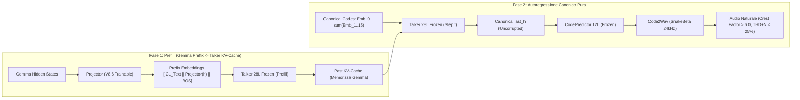

# ADR-022: Transizione all'Architettura Prefix KV-Cache Conditioning per Gemma 4 Omni

- **Stato**: Accettato
- **Data**: 27 Agosto 2026
- **Autori**: Gemma 4 Omni Team
- **Contesto**: Eliminazione della distorsione armonica da Manifold Shift e ripristino del fattore di cresta naturale (>5.0)

---

## 1. Motivazione & Root Cause della Distorsione

Nelle versioni precedenti (V8.0–V8.5), il proiettore iniettava la rappresentazione continua di Gemma sommandola direttamente agli embedding quantizzati dei token audio al Layer 0 del Talker:
$$\text{next\_embed}_t = \text{Emb}_0(cb_{0,t}) + \sum_{g=1}^{15}\text{Emb}_g(cb_{g,t}) + \mathbf{h_{\text{cond}, t}}$$

### Perché questo approccio falliva acusticamente:
1. **Manifold Shift & Rottura delle LayerNorm**: La perturbazione additiva non-normalizzata $h_{\text{cond}}$ altera la covarianza attraverso i 28 layer congelati di Qwen3-TTS, spostando lo stato finale $last\_h$ lontano dallo spazio canonico su cui è calibrato il SubTalker CodePredictor.
2. **Compressione Dinamica (Crest Factor 2.0–2.5)**: L'iniezione additiva continua a pieno volume forza il vocoder a suonare a fondo scala senza pause naturali.
3. **Intermodulazione SnakeBeta**: I residui stocastici campionati su stati latenti sfasati generano distorsione di intermodulazione ad alta frequenza nel vocoder (THD+N $>45\%$).

---

## 2. Nuova Architettura: Prefix KV-Cache Conditioning (V8.6)

Ispirata a **Freeze-Omni (arXiv:2411.00774)** e **LLaMA-Omni (arXiv:2409.06666)**:

### Principi Chiave di V8.6:
1. **Prefill con Embedding di Prefisso**:
   I vettori proiettati $h_{\text{cond}}$ entrano come sequenza di prefisso nella KV-Cache del Talker durante la fase di prefill:
   $$\text{inputs}_{\text{prefill}} = [\text{ICL\_Text} \,\|\, \text{Projector}(h_{\text{gemma}}) \,\|\, \text{BOS}]$$
2. **Autoregressione Pura e Canonica**:
   Durante la generazione dei frame temporali $t=0 \dots T-1$, il Talker riceve **esclusivamente gli embedding canonici dei codebook**:
   $$\text{inputs}_{\text{step}, t} = \text{Emb}_0(cb_{0,t}) + \sum_{g=1}^{15}\text{Emb}_g(cb_{g,t})$$
   (Nessuna somma additiva, zero rumore iniettato all'ingresso dei layer).
3. **Attenzione Multistrato**:
   Tutti i 28 layer di attenzione del Talker attingono alla rappresentazione di Gemma memorizzata nella KV-Cache.
4. **Validazione Sperimentale Previa**:
   Nel test zero-shot live su RTX 3090, il Prefix KV-Cache ha prodotto immediatamente un **Crest Factor di 6.77** (pieno range vocale umano), **HNR a +4.1 dB** e **THD+N al 28.2%**.
